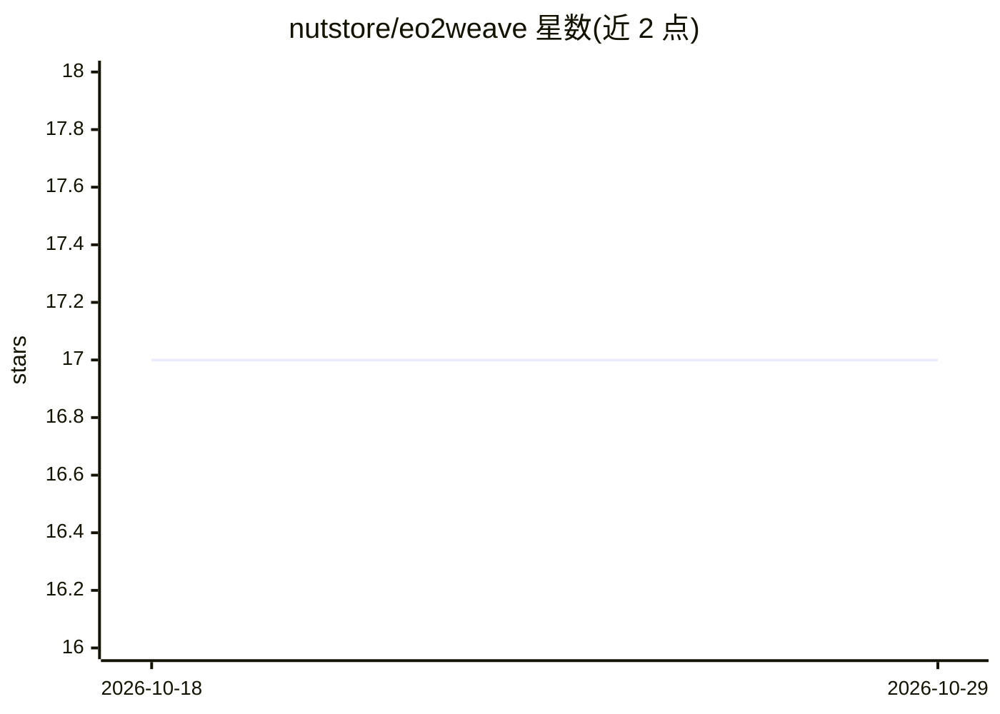

# nutstore/eo2weave

⭐ 17 · TypeScript · MIT · 推送 2026-10-28 · [GitHub](https://github.com/nutstore/eo2weave) · [官网](https://weave.eo2suite.com) · 组织维护 · 中文 README

**本地优先的浏览器端 AI 创作与多智能体协作平台**

浏览器内运行的本地优先 AI 创作平台，面向创作者、开发者与数据分析师：提供 AI 对话与代码智能（30+ 工具）、知识工作流、多智能体编排、通过 File System Access API 直接访问本地文件、基于 Pyodide 在浏览器执行 Python（pandas/numpy/matplotlib），并支持 MCP 与 WebMCP 工具发现。文件、会话与设置存储于浏览器 OPFS，无后端无追踪，AI 请求以 BYOK 方式直连用户配置的 LLM 供应商。限制：需 Chrome/Edge 86+ 等支持 File System Access API 的浏览器，Firefox/Safari 为部分或不支持；从源码构建需 Node.js 18+ 与 pnpm。

## 筛选速览

| 维度 | 判定 | 备注 |
|---|---|---|
| AI 角色 | `ai-native` | 本体是模型或模型工具 |
| 许可风险 | `permissive` | MIT |
| 部署形态 | `None` |  |
| 模型依赖 | — | README 未给出锁定关系 |
| 硬件要求 | — | 无带数字的原话,不猜 |
| 安装摩擦 | `low` | 无编译、无系统依赖或容器化 |
| 成熟度 | — | 结构信号不足 |

## 能力要点

- 本地优先：文件与会话存于浏览器 OPFS，AI 请求 BYOK 直连供应商
- 浏览器内执行 Python（Pyodide，含 pandas/numpy/matplotlib）
- 多智能体编排与 30+ 代码智能工具
- WebMCP 标准工具发现与配套浏览器扩展

## 适用场景

- 在浏览器里对本地代码库进行 AI 对话、重构与审查
- 用浏览器内 Python 做数据探索、可视化与报告生成
- 编排多智能体执行多步内容创作工作流

## 场景标签

`多智能体` `数据分析` `编码 Agent` · 领域:Agent 开发

## 证据(README 行号)

> L19: EO2Weave is a **local-first AI-native creation platform**. It combines file workflows, AI copilots, knowledge-base 
> L32: - **AI-Powered Conversations**: Chat naturally with your codebase using advanced AI agents with multi-agent collabo

## 星数曲线

2026-10-18 17 → 2026-10-29 17（+0）

---
*卡片 v1 · prompt 1.4 · 生成 2026-10-29 · 置信度 high · 依据 README sha `8db14462cb1c` · [字段定义](../../DATASET.md)*
