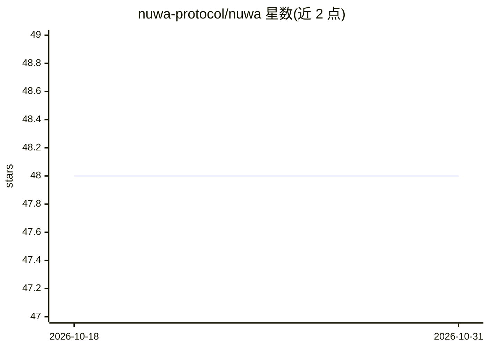

# nuwa-protocol/nuwa

⭐ 48 · TypeScript · Apache-2.0 · 推送 2026-02-11 · [GitHub](https://github.com/nuwa-protocol/nuwa) · [官网](https://nuwa.dev) · 组织维护

**Nuwa 协议 monorepo：DID 认证与加密货币支付的 AI agent 平台**

Nuwa 是一个 monorepo，包含 AI 平台的协议规范与产品组件：用户通过 Nuwa Client（AI 聊天客户端）以 DID 去中心化身份认证访问 AI 服务并用加密货币直接向模型/agent 开发者付费；开发者用 Nuwa Kit 将工具或服务封装为 Cap（Model、Prompt 与 MCP 组成的抽象）并直接获得收入。仓库内含协议提案（nips）、智能合约信息、客户端实现、多语言 SDK、参考服务实现与网站。许可为 Apache-2.0。README 未给出具体安装运行命令。

## 筛选速览

| 维度 | 判定 | 备注 |
|---|---|---|
| AI 角色 | `ai-ecosystem` | LLM/agent 周边工具 |
| 许可风险 | `permissive` | Apache-2.0 |
| 部署形态 | `None` |  |
| 模型依赖 | — | README 未给出锁定关系 |
| 硬件要求 | — | 无带数字的原话,不猜 |
| 安装摩擦 | `low` | 无编译、无系统依赖或容器化 |
| 成熟度 | — | 结构信号不足 |

## 能力要点

- DID 去中心化身份认证 + 加密货币直接付费给开发者的 AI 平台
- Cap 抽象：Model + Prompt + MCPs 封装 AI 能力
- monorepo 含协议提案、智能合约、客户端、多语言 SDK 与参考服务

## 适用场景

- 用一个客户端统一访问多个 AI 模型与 agent
- 将 AI 服务封装为 Cap 并直接向用户收费
- 参与或查阅 Nuwa 协议规范（NIP）制定

## 场景标签

`聊天机器人` · 领域:对话与助手

## 证据(README 行号)

> L30: ** 🧰 Nuwa Kit**
> L41: - **`nuwa-services/`**: Reference implementations of key Nuwa Services (e.g., Custodian Service, LLM Proxy Service)

## 星数曲线

2026-10-18 48 → 2026-10-31 48（+0）

---
*卡片 v1 · prompt 1.4 · 生成 2026-10-25 · 置信度 mid · 依据 README sha `e45ecb721ffe` · [字段定义](../../DATASET.md)*
