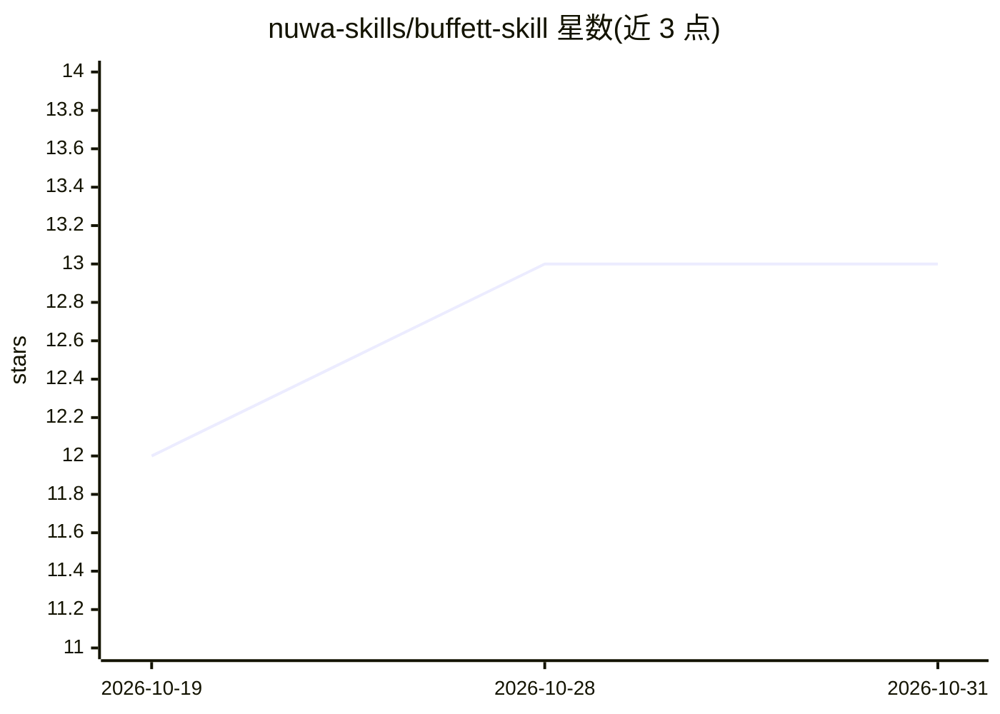

# nuwa-skills/buffett-skill

⭐ 13 · MIT · 推送 2026-10-18 · [GitHub](https://github.com/nuwa-skills/buffett-skill) · 组织维护 · 中文 README

**巴菲特投资思维人设 Skill：供 Agent 客户端安装使用**

一个以 SKILL.md 形式发布的 agent 技能包，将巴菲特的价值投资认知框架提炼为可安装的人设：包含 5 个思想模型（护城河、安全边际、能力圈、市场先生、复利）、7 条处世启发式和表达风格（句式/词汇/教学方式），并保留其投资生涯中的矛盾点。调研基于伯克希尔致股东信、股东大会记录、《滚雪球》等 30+ 一手与二手来源，参考文件存于 references/ 目录。通过 npx skills add 安装，在 Claude Code 等 Agent Skills 客户端中调用；示例对话存于 examples/ 目录。

## 筛选速览

| 维度 | 判定 | 备注 |
|---|---|---|
| AI 角色 | `ai-knowledge` | 知识聚合/清单类 |
| 许可风险 | `permissive` | MIT |
| 部署形态 | `library` | 以包/库形式分发 |
| 模型依赖 | — | README 未给出锁定关系 |
| 硬件要求 | — | 无带数字的原话,不猜 |
| 安装摩擦 | `low` | 无编译、无系统依赖或容器化 |
| 成熟度 | — | 结构信号不足 |

## 能力要点

- 5 个核心思想模型 + 7 条启发式 + 表达 DNA 的人格化输出
- 基于伯克希尔致股东信等 30+ 来源的调研，参考文件随仓库提供
- 以 SKILL.md 格式发布，npx 一条命令安装
- 保留巴菲特投资生涯中的矛盾点（价值投资 vs 科技投资等）

## 适用场景

- 让 agent 以巴菲特的投资框架分析商业模式或决策
- 在 Agent Skills 客户端中切换投资顾问人设
- 研究如何将人物认知框架蒸馏为 agent skill

## 场景标签

`提示工程` · 领域:Agent 开发

## 证据(README 行号)

> L9: **巴菲特的认知操作系统。不是语录合集，是可运行的投资思维框架。**
> L42: npx skills add nuwa-skills/buffett-skill
> L100: ├── SKILL.md                          # 可直接安装使用

## 星数曲线

2026-10-19 12 → 2026-10-31 13（+1）

---
*卡片 v1 · prompt 1.4 · 生成 2026-10-31 · 置信度 mid · 依据 README sha `6a25b53dc085` · [字段定义](../../DATASET.md)*
