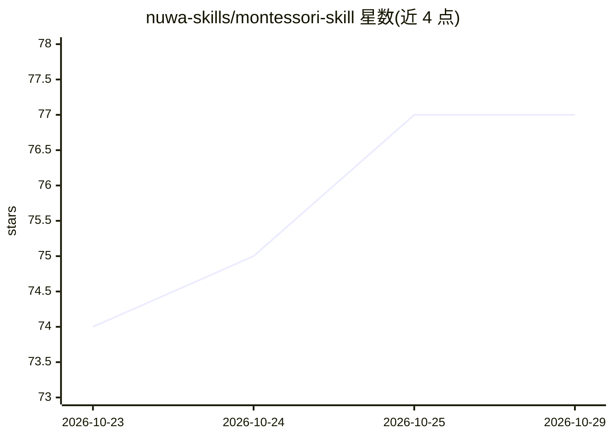

# nuwa-skills/montessori-skill

⭐ 77 · MIT · 推送 2026-10-18 · [GitHub](https://github.com/nuwa-skills/montessori-skill) · 组织维护 · 中文 README

**让 AI 以蒙特梭利教育视角回应育儿问题的 agent 技能包**

面向 Claude 类 agent 框架的人物 Skill：将蒙特梭利教育哲学（吸收性心智、敏感期、预备好的环境、观察法、内在动机）蒸馏为 SKILL.md 格式的思维框架，安装后 AI 以蒙特梭利视角回答儿童学习、家庭环境布置、同伴冲突等育儿问题。提供 npx skills add 一条命令安装，调研来源标注蒙特梭利原著与 AMS/AMI 文献。属于 Nuwa 人物技能生态中的一个条目。

## 筛选速览

| 维度 | 判定 | 备注 |
|---|---|---|
| AI 角色 | `ai-native` | 本体是模型或模型工具 |
| 许可风险 | `permissive` | MIT |
| 部署形态 | `library` | 以包/库形式分发 |
| 模型依赖 | — | README 未给出锁定关系 |
| 硬件要求 | — | 无带数字的原话,不猜 |
| 安装摩擦 | `low` | 无编译、无系统依赖或容器化 |
| 成熟度 | — | 结构信号不足 |

## 能力要点

- 将蒙特梭利教育哲学提炼为 6 项 AI 可执行的思维框架
- 以 SKILL.md 定义文件形式接入 agent 框架
- 调研来源标注蒙特梭利原著与 AMS/AMI 文献
- npx 一条命令安装

## 适用场景

- 让 AI 以蒙特梭利视角解答孩子学习与行为问题
- 获得以儿童尺度设计家庭环境的建议
- 了解蒙特梭利教育与传统教育的理念差异

## 场景标签

`提示工程` · 领域:Agent 开发

## 证据(README 行号)

> L6: Agent Skills
> L44: 本 Skill 将蒙特梭利教育哲学蒸馏为 AI 可执行的思维框架：
> L67: ├── SKILL.md                        # 核心 Skill 定义文件

## 星数曲线

2026-10-23 74 → 2026-10-29 77（+3）

---
*卡片 v1 · prompt 1.4 · 生成 2026-10-24 · 置信度 high · 依据 README sha `dba8cbef6538` · [字段定义](../../DATASET.md)*
