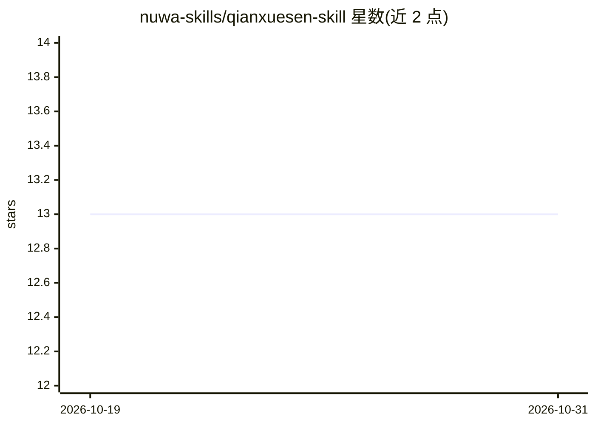

# nuwa-skills/qianxuesen-skill

⭐ 13 · MIT · 推送 2026-10-18 · [GitHub](https://github.com/nuwa-skills/qianxuesen-skill) · 个人维护 · 中文 README

**让 AI agent 以钱学森视角思考的 persona 技能包**

面向 Agent Skills/Nuwa 生态的人物技能包：通过 SKILL.md 定义文件，将钱学森的系统工程思想（开放的复杂巨系统、综合集成法、总体设计部与归零制度、大成智慧学等）注入 agent 的对话人格，使其以该视角回答系统设计、跨学科思维、质量管理与技术规划类问题。以 npx 命令安装，内容调研来源于钱学森著作与传记等文献。仅含人格与思维框架，不绑定任何具体模型。

## 筛选速览

| 维度 | 判定 | 备注 |
|---|---|---|
| AI 角色 | `ai-ecosystem` | LLM/agent 周边工具 |
| 许可风险 | `permissive` | MIT |
| 部署形态 | `library` | 以包/库形式分发 |
| 模型依赖 | — | README 未给出锁定关系 |
| 硬件要求 | — | 无带数字的原话,不猜 |
| 安装摩擦 | `low` | 无编译、无系统依赖或容器化 |
| 成熟度 | — | 结构信号不足 |

## 能力要点

- 以 SKILL.md 格式定义 persona，兼容 Agent Skills/Nuwa 生态
- 蒸馏钱学森系统工程方法论（总体设计部、归零制度、综合集成法）
- 调研来源列出钱学森著作、传记与档案文献

## 适用场景

- 给 Claude 类 agent 安装钱学森思维人格进行对话
- 团队用系统工程视角讨论架构与质量管理问题
- 作为人物 Skill 合集中的一个 persona 选装

## 场景标签

`提示工程` · 领域:Agent 开发

## 证据(README 行号)

> L6: Agent Skills
> L66: ├── SKILL.md                          # 核心 Skill 定义文件

## 星数曲线

2026-10-19 13 → 2026-10-31 13（+0）

---
*卡片 v1 · prompt 1.4 · 生成 2026-10-31 · 置信度 high · 依据 README sha `930ee7eb66f5` · [字段定义](../../DATASET.md)*
