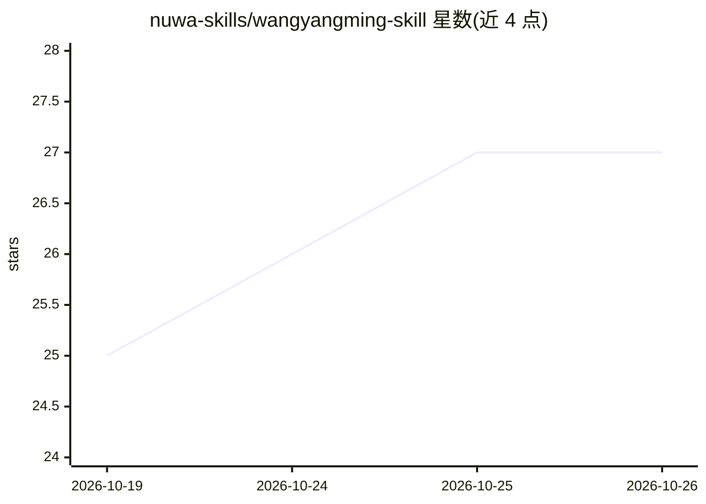

# nuwa-skills/wangyangming-skill

⭐ 27 · MIT · 推送 2026-10-18 · [GitHub](https://github.com/nuwa-skills/wangyangming-skill) · 组织维护 · 中文 README

**王阳明人格的 Agent Skill：以心学框架进行对话分析**

一个可安装到 Agent Skills 客户端的人物 Skill 文件（SKILL.md），以王阳明的认知框架回应用户问题。基于《传习录》《王阳明全集》等一手文献及陈来、冈田武彦等研究共 30+ 来源调研，提炼 5 个核心思想模型（知行合一、致良知、心即理、事上磨练、去人欲存天理）、7 条处世启发式与表达风格设定，并保留人物的思想矛盾。通过 npx skills add 命令安装，在 Claude Code 等客户端中调用。

## 筛选速览

| 维度 | 判定 | 备注 |
|---|---|---|
| AI 角色 | `ai-native` | 本体是模型或模型工具 |
| 许可风险 | `permissive` | MIT |
| 部署形态 | `library` | 以包/库形式分发 |
| 模型依赖 | — | README 未给出锁定关系 |
| 硬件要求 | — | 无带数字的原话,不猜 |
| 安装摩擦 | `low` | 无编译、无系统依赖或容器化 |
| 成熟度 | — | 结构信号不足 |

## 能力要点

- 基于 30+ 来源调研提炼 5 个思想模型与 7 条处世启发式
- 以认知框架分析问题而非复读语录
- 设定表达风格并保留人物思想矛盾
- 提供 examples/ 目录 4 轮对话记录

## 适用场景

- 在 Agent 客户端中以王阳明视角分析个人困惑与决策
- 用知行合一、致良知等框架审视自身问题
- 作为人物 Skill 的范本了解人格化 prompt 设计

## 场景标签

`提示工程` `聊天机器人` · 领域:Agent 开发

## 证据(README 行号)

> L9: **王阳明的认知操作系统。不是语录合集，是可运行的思维框架。**
> L100: ├── SKILL.md                          # 可直接安装使用
> L45: 然后在 Claude Code 等 Agent Skills 客户端里：

## 星数曲线

2026-10-19 25 → 2026-10-26 27（+2）

---
*卡片 v1 · prompt 1.4 · 生成 2026-10-26 · 置信度 high · 依据 README sha `2a65490bb359` · [字段定义](../../DATASET.md)*
