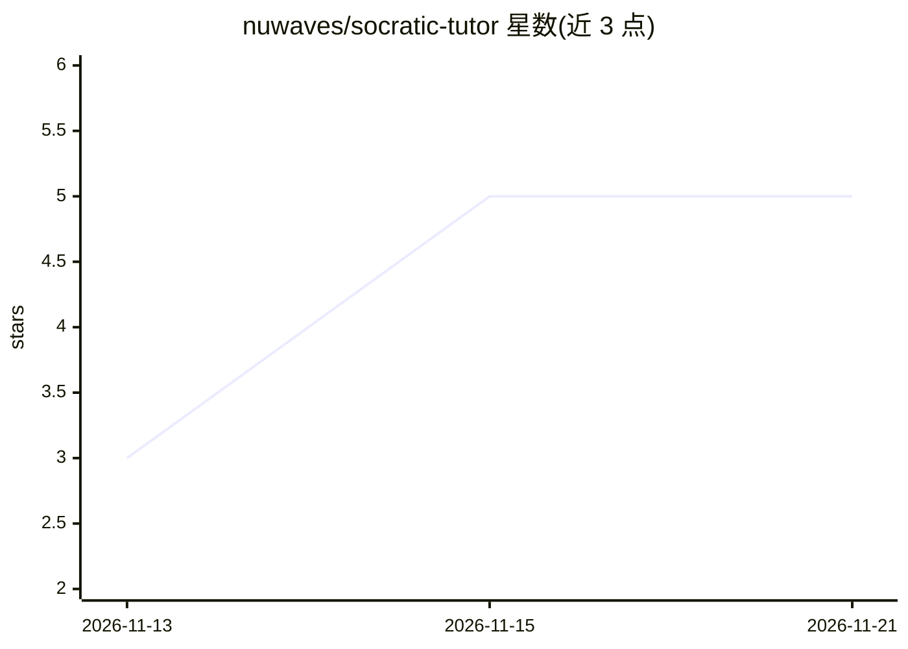

# nuwaves/socratic-tutor

⭐ 5 · MIT · 推送 2026-11-09 · [GitHub](https://github.com/nuwaves/socratic-tutor) · [官网](https://nuwaves.xyz) · 个人维护

**把 LLM 变成苏格拉底式私人导师的 agent 技能**

一个基于 SKILL.md 格式的 agent 技能：通过简短契约（目标、时长、水平）、诊断测试、0-5 级技能地图、逐题提问、间隔复习（2/4/10/30 天）与最终评估来教授任意主题。支持读写 tutor/<topic>.md 保存进度，无文件权限时以粘贴文本块方式保存。限制：本质是提示词，等级判定依赖模型自身，聊天之外不运行任何程序。

## 筛选速览

| 维度 | 判定 | 备注 |
|---|---|---|
| AI 角色 | `ai-native` | 本体是模型或模型工具 |
| 许可风险 | `permissive` | MIT |
| 部署形态 | `None` |  |
| 模型依赖 | — | README 未给出锁定关系 |
| 硬件要求 | — | 无带数字的原话,不猜 |
| 安装摩擦 | `low` | 无编译、无系统依赖或容器化 |
| 成熟度 | — | 结构信号不足 |

## 能力要点

- 技能地图按 0-5 级组织，Level 5 要求交付可运行代码或书面成果
- 间隔复习计划（2/4/10/30 天）与 review due/pause/drop 命令
- 有时效性事实（API、价格、版本）须经来源核验或标注，不从记忆教授
- 卡壳机制：两次失败后给出例题、前置知识绕行或直接告知

## 适用场景

- 用支持 SKILL.md 的编码 agent 学一门新技能
- 在普通聊天机器人中粘贴系统提示做苏格拉底式学习
- 需要间隔复习和进度记录的长期自学

## 场景标签

`提示工程` `聊天机器人` · 领域:Agent 开发

## 证据(README 行号)

> L3: An agent skill that turns an LLM into a strict personal tutor. It teaches a topic of your choice with the Socratic m
> L23: With a coding agent that supports `SKILL.md`, copy this directory into your skills folder and say "teach me X". Wit
> L27: The tutor is a prompt. The model grades the answers, so levels are only as reliable as the model. Nothing runs outs

## 星数曲线

2026-11-13 3 → 2026-11-21 5（+2）

---
*卡片 v1 · prompt 1.4 · 生成 2026-11-21 · 置信度 high · 依据 README sha `9bacde4ca395` · [字段定义](../../DATASET.md)*
