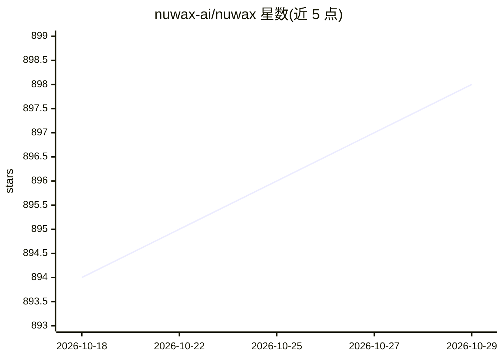

# nuwax-ai/nuwax

⭐ 898 · TypeScript · Apache-2.0 · 推送 2026-10-28 · [GitHub](https://github.com/nuwax-ai/nuwax) · [官网](https://nuwax.com) · 组织维护 · 中文 README

**企业级 AI Agent 开发运营平台：私有化构建与部署智能体**

Nuwax Agent OS 是私有化部署的 Agentic AI 平台，覆盖 agent 创建与分发、知识库管理、模型代理、记忆系统与插件生态，由十余个关联仓库组成（前端、后端、agent 引擎 nuwaxcode、沙箱调度 rcoder、MCP 服务等）。通过 nuwax-cli 在本地 Docker 环境部署，支持主服务与 Agent Computer 沙箱分离部署，提供备份、回滚、自动升级命令。要求 Ubuntu 22.04+/macOS 10.15+、4 核 8GB 内存以上；Windows 支持尚未推出。

## 筛选速览

| 维度 | 判定 | 备注 |
|---|---|---|
| AI 角色 | `ai-ecosystem` | LLM/agent 周边工具 |
| 许可风险 | `permissive` | Apache-2.0 |
| 部署形态 | `self-host` | docker 或自建部署 |
| 模型依赖 | — | README 未给出锁定关系 |
| 硬件要求 | — | 无带数字的原话,不猜 |
| 安装摩擦 | `low` | 无编译、无系统依赖或容器化 |
| 成熟度 | `idea` | |

## 能力要点

- nuwax-cli 一键本地部署，含启动/备份/回滚/自动升级命令
- 主服务与 Agent Computer 沙箱可分布式分离部署
- 十余个关联仓库覆盖前端、后端、agent 引擎、沙箱调度与 MCP 服务

## 适用场景

- 私有化部署企业 AI Agent 平台
- 构建带知识库与记忆系统的智能体
- 在多台服务器上分布式运行 agent 沙箱

## 场景标签

`RAG` `Agent 框架` · 领域:Agent 开发

## 证据(README 行号)

> L3: Nuwax AI - Easily build and deploy your private Agentic AI solutions.
> L147: The Nuwax AI Agent Platform consists of multiple interconnected repositories:
> L13: Use the official nuwax-cli command tool to quickly deploy services locally.

## 星数曲线

2026-10-18 894 → 2026-10-29 898（+4）

---
*卡片 v1 · prompt 1.4 · 生成 2026-10-21 · 置信度 high · 依据 README sha `8078e2a3dbf3` · [字段定义](../../DATASET.md)*
