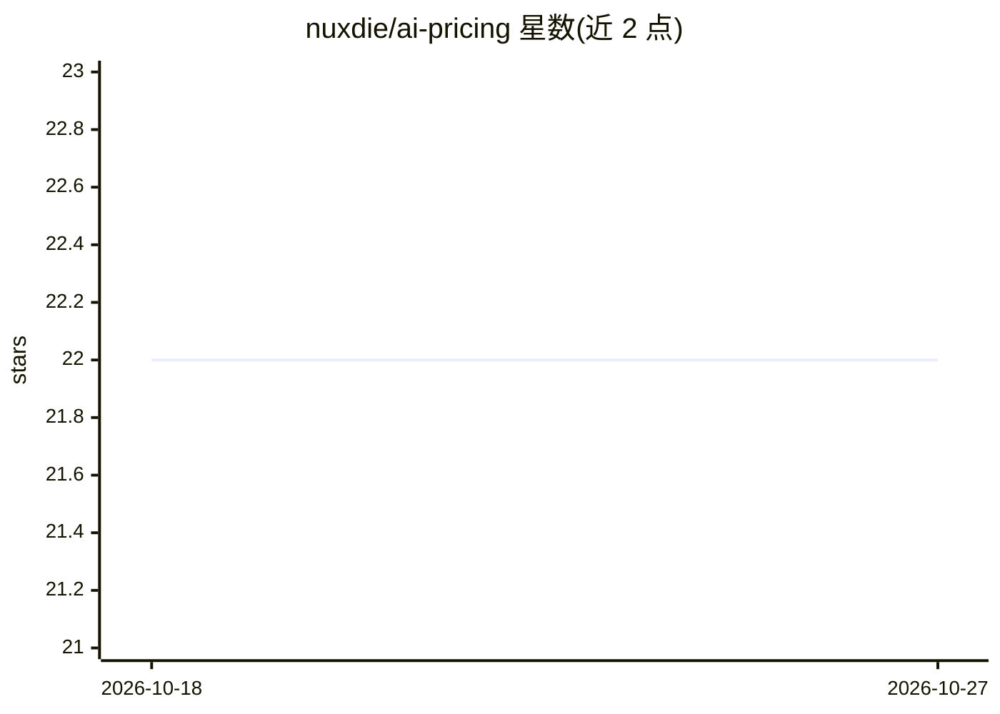

# nuxdie/ai-pricing

⭐ 22 · TypeScript · MIT · 推送 2026-10-25 · [GitHub](https://github.com/nuxdie/ai-pricing) · [官网](https://ai.tsatsin.com/) · 个人维护

**对比各厂商 AI 模型价格与性能的交互式 Web 应用**

基于 React/TypeScript 的交互式网页应用，把分散在各厂商定价页与基准测试站点的信息汇集到一处，供用户横向比较模型的价格、速度、输出长度与基准表现。提供可排序、过滤与拖拽的列，悬浮提示解释指标，附官方模型页链接，数据靠公开基准数据与人工持续更新。给需要在选型时快速权衡性价比的开发者与产品决策者使用。

## 筛选速览

| 维度 | 判定 | 备注 |
|---|---|---|
| AI 角色 | `ai-knowledge` | 知识聚合/清单类 |
| 许可风险 | `permissive` | MIT |
| 部署形态 | `None` |  |
| 模型依赖 | — | README 未给出锁定关系 |
| 硬件要求 | — | 无带数字的原话,不猜 |
| 安装摩擦 | `low` | 无编译、无系统依赖或容器化 |
| 成熟度 | — | 结构信号不足 |

## 能力要点

- 跨厂商汇总价格、速度、verbosity 与基准数据到单一界面
- 列支持排序、过滤与拖拽
- 悬浮提示解释不直观的指标并链接官方模型页
- 随模型与定价变化持续更新数据

## 适用场景

- 挑选性价比合适的模型再接入产品
- 比较更快模型或更高编码得分的溢价
- 避免在多个定价页与基准站之间来回切换

## 场景标签

`模型评测` · 领域:评测与运维

## 证据(README 行号)

> L3: A fast, interactive web app for comparing AI models across the metrics that actually matter when choosing what to us
> L9: When you're comparing models across providers, the information is usually scattered across pricing pages, benchmark 

## 星数曲线

2026-10-18 22 → 2026-10-27 22（+0）

---
*卡片 v1 · prompt 1.4 · 生成 2026-10-27 · 置信度 high · 依据 README sha `98e1b2b40533` · [字段定义](../../DATASET.md)*
