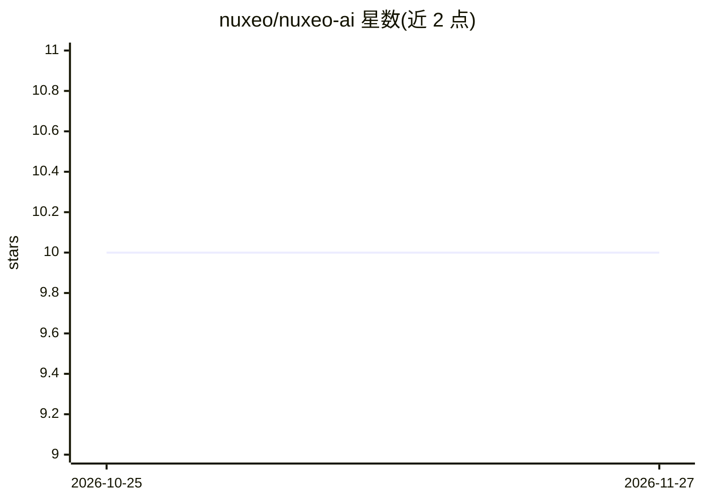

# nuxeo/nuxeo-ai

⭐ 10 · Java · Apache-2.0 · 推送 2026-11-26 · [GitHub](https://github.com/nuxeo/nuxeo-ai) · 组织维护

**Nuxeo 平台的 AI 富化扩展：为文档内容接入 AI 服务**

Nuxeo Platform 的 AI 核心插件，提供 3 个包：nuxeo-ai-core（核心接口与 AI 组件）、nuxeo-ai-image-quality（基于 Sightengine 的富化服务）、nuxeo-ai-aws（基于 AWS 的富化服务）。通过 Nuxeo Stream 流处理管道监听图片/视频/音频/文本内容变化，调用 EnrichmentProvider 富化服务并将标签保存为文档标签或 facet，支持连续导出 TF Record 训练数据、自定义 REST 富化服务接入，并输出流处理与富化调用指标。需通过 nuxeoctl mp-install 安装，按 Nuxeo 版本对应插件版本。

## 筛选速览

| 维度 | 判定 | 备注 |
|---|---|---|
| AI 角色 | `ai-ecosystem` | LLM/agent 周边工具 |
| 许可风险 | `permissive` | Apache-2.0 |
| 部署形态 | `None` |  |
| 模型依赖 | — | README 未给出锁定关系 |
| 硬件要求 | — | 无带数字的原话,不猜 |
| 安装摩擦 | `low` | 无编译、无系统依赖或容器化 |
| 成熟度 | — | 结构信号不足 |

## 能力要点

- 基于 Nuxeo Stream 的图片/视频/音频/文本富化管道
- 可自定义 EnrichmentProvider 与 REST 富化服务
- 连续导出 TF Record 训练数据并按 cron 触发
- 内置富化调用指标监控（调用/错误/重试/熔断计数）

## 适用场景

- 为 Nuxeo 内容库中的图片自动打标签
- 在文档入库时调用云 AI 服务生成元数据
- 导出文档数据用于训练自定义模型

## 场景标签

`目标检测` `多模态` · 领域:感知与多模态

## 证据(README 行号)

> L3: Core functionality for using AI with the Nuxeo Platform.
> L163: * Provides an `AIComponent` to register services. eg. An enrichment service.
> L218: * Configures an `EnrichingStreamProcessor` to read from the `images` stream, calls the `aws.celebrityDetection`

## 星数曲线

2026-10-25 10 → 2026-11-27 10（+0）

---
*卡片 v1 · prompt 1.4 · 生成 2026-11-19 · 置信度 high · 依据 README sha `dcc5f055cad1` · [字段定义](../../DATASET.md)*
