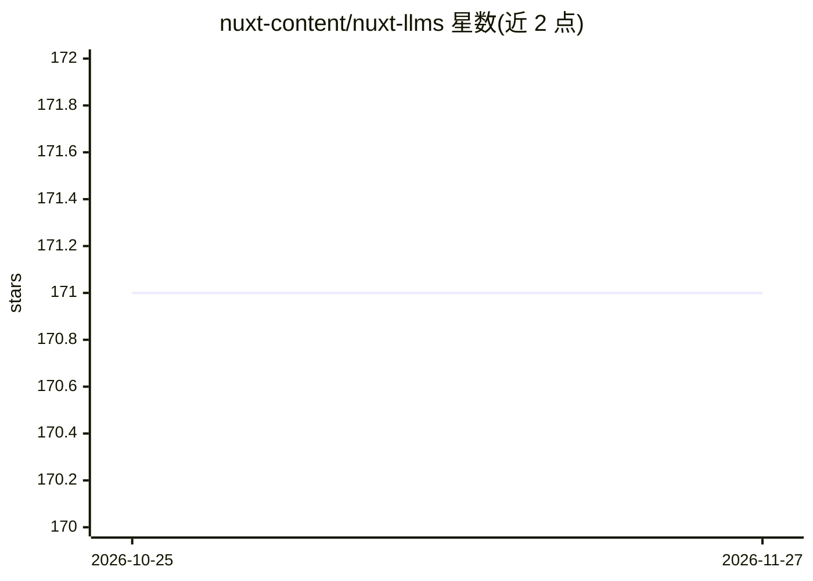

# nuxt-content/nuxt-llms

⭐ 171 · TypeScript · MIT · 推送 2026-11-26 · [GitHub](https://github.com/nuxt-content/nuxt-llms) · 组织维护

**为 Nuxt 应用自动生成 llms.txt 文档的模块**

一个 Nuxt 模块，为应用自动生成并预渲染遵循 llms.txt 规范的 markdown 文档路由 /llms.txt，可选启用更详细的 /llms-full.txt。通过 nuxt.config.ts 配置标题、描述、sections 与 notes，提供 llms:generate 与 llms:generate:full 两个运行时钩子，供应用插件或其他 Nuxt 模块（如 @nuxt/content）动态注入内容。支持构建时预渲染或动态服务，可选 UTF-8 BOM 处理非拉丁字符。安装方式为 npm 安装并注册模块，MIT 许可。

## 筛选速览

| 维度 | 判定 | 备注 |
|---|---|---|
| AI 角色 | `ai-ecosystem` | LLM/agent 周边工具 |
| 许可风险 | `permissive` | MIT |
| 部署形态 | `library` | 以包/库形式分发 |
| 模型依赖 | — | README 未给出锁定关系 |
| 硬件要求 | — | 无带数字的原话,不猜 |
| 安装摩擦 | `low` | 无编译、无系统依赖或容器化 |
| 成熟度 | — | 结构信号不足 |

## 能力要点

- 自动生成并预渲染遵循 llms.txt 规范的 /llms.txt 路由
- 可选启用 /llms-full.txt 详细文档路由
- 提供 llms:generate / llms:generate:full 运行时钩子供扩展
- 与 @nuxt/content 模块集成，自动纳入站点内容

## 适用场景

- 为自己的 Nuxt 网站生成 LLM 可读的文档入口
- 结合 Nuxt Content 将内容站输出为 llms.txt
- 通过钩子把 CMS 等外部数据源注入文档

## 场景标签

 · 领域:Web 开发工具/LLM 文档规范

## 证据(README 行号)

> L10: Nuxt LLMs automatically generates `llms.txt` markdown documentation for your Nuxt application. It provides runtime 
> L19: - Integrates with Nuxt modules and your application via the runtime hooks system

## 星数曲线

2026-10-25 171 → 2026-11-27 171（+0）

---
*卡片 v1 · prompt 1.4 · 生成 2026-11-26 · 置信度 high · 依据 README sha `6aff8899e92b` · [字段定义](../../DATASET.md)*
