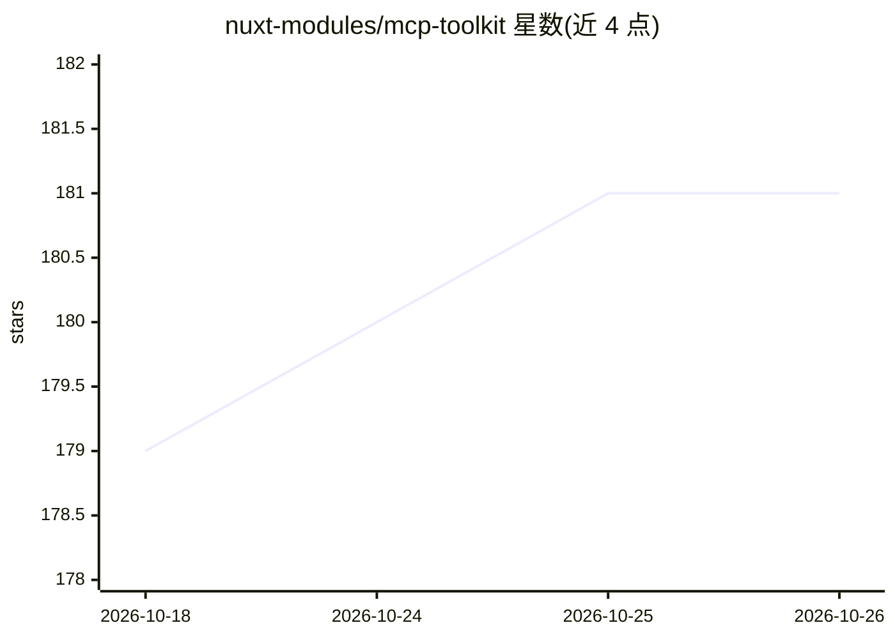

# nuxt-modules/mcp-toolkit

⭐ 181 · TypeScript · MIT · 推送 2026-10-19 · [GitHub](https://github.com/nuxt-modules/mcp-toolkit) · [官网](https://mcp-toolkit.nuxt.dev) · 组织维护

**Nuxt 模块：在 Nuxt 应用内直接创建 MCP 服务器**

面向 Nuxt 开发者的模型上下文协议（MCP）服务器构建模块：以文件约定方式自动发现并注册 tools、resources、prompts 与 apps，无需配置。支持在单应用中创建多个 MCP 端点、向 MCP Apps 兼容宿主提供 Vue UI 组件、在 Nuxt DevTools 中内置可视化调试器，并使用 Zod 做输入输出校验。另提供 Agent Skills，可让 AI 编码助手代为搭建、审查 MCP 实现。通过 npx nuxt add 或 npm 手动安装。

## 筛选速览

| 维度 | 判定 | 备注 |
|---|---|---|
| AI 角色 | `ai-ecosystem` | LLM/agent 周边工具 |
| 许可风险 | `permissive` | MIT |
| 部署形态 | `library` | 以包/库形式分发 |
| 模型依赖 | — | README 未给出锁定关系 |
| 硬件要求 | — | 无带数字的原话,不猜 |
| 安装摩擦 | `low` | 无编译、无系统依赖或容器化 |
| 成熟度 | — | 结构信号不足 |

## 能力要点

- 文件约定自动发现并注册 tools/resources/prompts
- 单应用支持多个 MCP 端点
- 内置 Nuxt DevTools 可视化调试器与 Zod 校验
- 提供 Agent Skills 供 AI 编码助手搭建与审查 MCP 实现

## 适用场景

- 在现有 Nuxt 应用中为自己的产品暴露 MCP 工具
- 向 MCP Apps 兼容宿主提供交互式 Vue UI 组件
- 让 AI 编码助手按最佳实践创建与排查 MCP 实现

## 场景标签

 · 领域:Web 开发/LLM 基础设施

## 证据(README 行号)

> L12: A Nuxt module to easily create a Model Context Protocol (MCP) server directly in your Nuxt application. Define MCP 
> L16: - 🎯 **Zero Configuration** - Automatic discovery of tools, resources, prompts, and apps

## 星数曲线

2026-10-18 179 → 2026-10-26 181（+2）

---
*卡片 v1 · prompt 1.4 · 生成 2026-10-22 · 置信度 high · 依据 README sha `f07e4b667011` · [字段定义](../../DATASET.md)*
