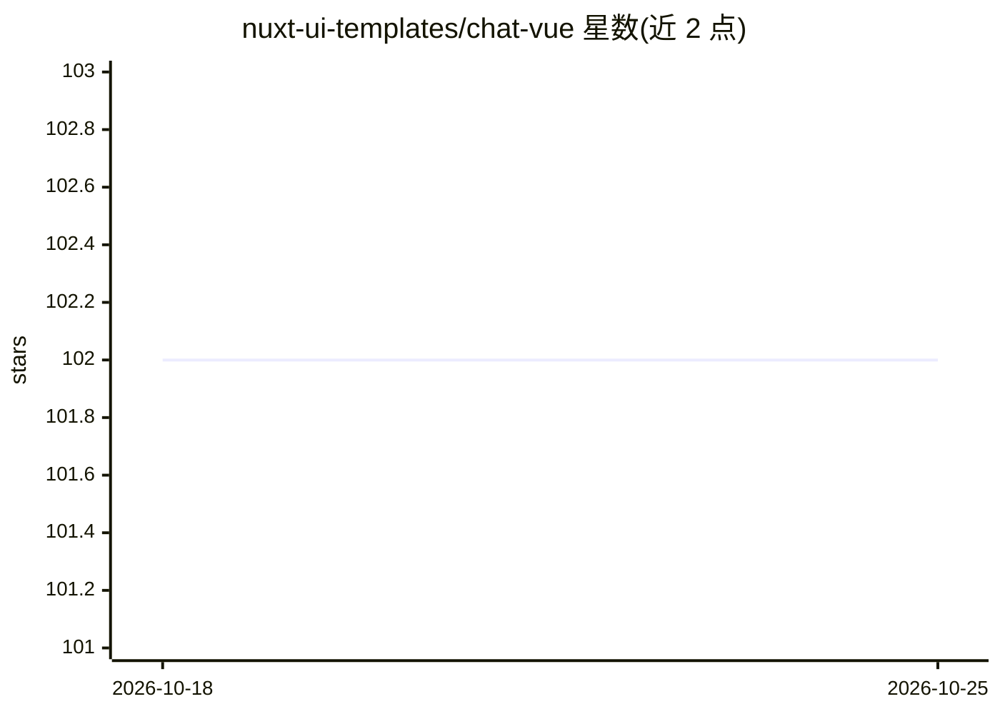

# nuxt-ui-templates/chat-vue

⭐ 102 · TypeScript · MIT · 推送 2026-10-22 · [GitHub](https://github.com/nuxt-ui-templates/chat-vue) · [官网](https://chat-vue-template.nuxt.dev) · 组织维护

**面向 Vue 开发者的 AI 聊天应用模板（Nuxt UI + AI SDK）**

基于 Nuxt UI、Nitro、Vite 与 Vercel AI SDK 构建的 Vue AI 聊天应用模板，供开发者快速起步搭建聊天机器人。内置流式 AI 消息（含 thinking/reasoning）、经 Vercel AI Gateway 接入 Claude Haiku 4.5/Gemini 3 Flash/GPT-5 Nano 多模型、Web 搜索工具、WebSocket 流式听写、图表与天气工具调用、GitHub OAuth 认证、基于 SQLite（生产用 Turso）与 Drizzle ORM 的聊天历史持久化及明暗主题。通过 npm create 命令或 pnpm 安装依赖并运行数据库迁移后本地开发。

## 筛选速览

| 维度 | 判定 | 备注 |
|---|---|---|
| AI 角色 | `ai-ecosystem` | LLM/agent 周边工具 |
| 许可风险 | `permissive` | MIT |
| 部署形态 | `library` | 以包/库形式分发 |
| 模型依赖 | — | README 未给出锁定关系 |
| 硬件要求 | — | 无带数字的原话,不猜 |
| 安装摩擦 | `low` | 无编译、无系统依赖或容器化 |
| 成熟度 | — | 结构信号不足 |

## 能力要点

- 流式 AI 消息输出，支持 thinking/reasoning 展示
- 经 Vercel AI Gateway 接入多模型（Claude Haiku 4.5、Gemini 3 Flash、GPT-5 Nano）
- GitHub OAuth 认证 + SQLite/Turso/Drizzle ORM 聊天历史持久化
- Web 搜索、听写转录、图表与天气等工具调用

## 适用场景

- 快速搭建带认证与历史记录的 AI 聊天应用
- 学习 AI SDK 与 Nuxt UI 集成流式对话的最佳实践
- 部署到 Vercel 作为团队内部聊天机器人起点

## 场景标签

`聊天机器人` · 领域:对话与助手

## 证据(README 行号)

> L6: Full-featured AI Chatbot Vue application with authentication, chat history, collapsible sidebar, keyboard shortcuts,
> L21: - ⚡️ **Streaming AI messages** powered by the AI SDK with thinking/reasoning support

## 星数曲线

2026-10-18 102 → 2026-10-25 102（+0）

---
*卡片 v1 · prompt 1.4 · 生成 2026-10-23 · 置信度 high · 依据 README sha `d5cd0b84267e` · [字段定义](../../DATASET.md)*
