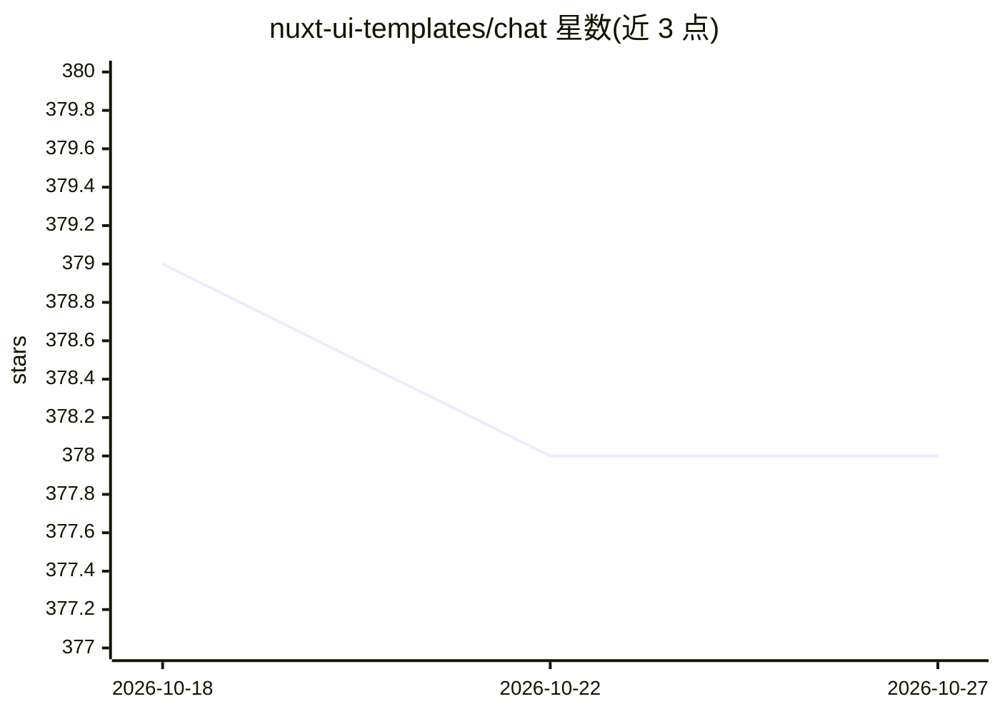

# nuxt-ui-templates/chat

⭐ 378 · Vue · MIT · 推送 2026-10-26 · [GitHub](https://github.com/nuxt-ui-templates/chat) · [官网](https://chat-template.nuxt.dev) · 组织维护

**Nuxt 全栈 AI 聊天机器人模板，含认证与聊天历史**

基于 Nuxt UI 组件与 Vercel AI SDK 构建的完整 AI 聊天应用模板：流式 AI 消息（含 thinking/reasoning）、通过 Vercel AI Gateway 接入 Claude Haiku 4.5、Gemini 3 Flash、GPT-5 Nano 多模型，支持 Web 搜索工具、WebSocket 听写转录、图表与天气工具调用渲染、GitHub OAuth 认证、基于 SQLite/Turso 与 Drizzle ORM 的聊天历史持久化、NuxtHub Blob 文件上传。面向 Nuxt/Vue 开发者快速搭建聊天应用，通过 npm create 命令或 pnpm 安装运行，本地开发需配置 AI Gateway API key，可选配置 GitHub OAuth 与 Blob 存储。

## 筛选速览

| 维度 | 判定 | 备注 |
|---|---|---|
| AI 角色 | `ai-native` | 本体是模型或模型工具 |
| 许可风险 | `permissive` | MIT |
| 部署形态 | `library` | 以包/库形式分发 |
| 模型依赖 | — | README 未给出锁定关系 |
| 硬件要求 | — | 无带数字的原话,不猜 |
| 安装摩擦 | `low` | 无编译、无系统依赖或容器化 |
| 成熟度 | — | 结构信号不足 |

## 能力要点

- 流式 AI 消息与 thinking/reasoning 支持
- 经 Vercel AI Gateway 接入 Claude/Gemini/GPT 多模型
- GitHub OAuth 认证与 SQLite/Turso + Drizzle ORM 聊天历史持久化
- Web 搜索、听写转录、工具调用（图表/天气）与文件上传

## 适用场景

- 用 Nuxt 快速搭建带认证和聊天历史的 AI 聊天应用
- 部署到 Vercel 获得自动配置的 AI Gateway 与数据库
- 作为学习 Nuxt UI + AI SDK 集成的起点模板

## 场景标签

`聊天机器人` · 领域:对话与助手

## 证据(README 行号)

> L5: Full-featured AI Chatbot Nuxt application with authentication, chat history, collapsible sidebar, keyboard shortcuts
> L21: - 🤖 **Multiple model support** — Claude Haiku 4.5, Gemini 3 Flash and GPT-5 Nano via Vercel AI Gateway

## 星数曲线

2026-10-18 379 → 2026-10-27 378（-1）

---
*卡片 v1 · prompt 1.4 · 生成 2026-10-21 · 置信度 high · 依据 README sha `185773ea27f2` · [字段定义](../../DATASET.md)*
