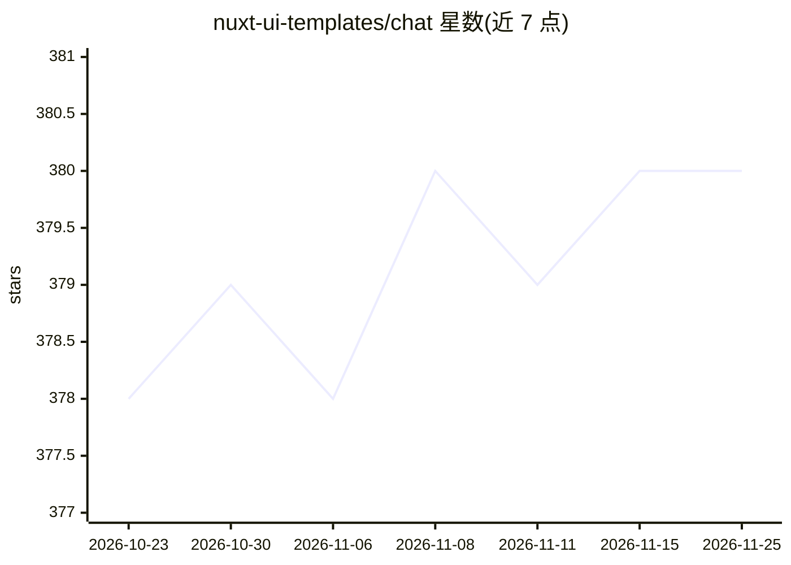

# nuxt-ui-templates/chat

⭐ 380 · Vue · MIT · 推送 2026-11-23 · [GitHub](https://github.com/nuxt-ui-templates/chat) · [官网](https://chat-template.nuxt.dev) · 组织维护

**开发者可复用的 Nuxt AI 聊天应用模板**

基于 Nuxt UI 与 Vercel AI SDK 的全功能聊天应用模板：流式 AI 回复（含思考/推理）、多模型接入、Web 搜索工具调用、语音听写转写、图表/天气工具的富 UI 渲染，并内置 GitHub OAuth 认证、SQLite/Turso 聊天历史持久化（Drizzle ORM）、文件上传、Markdown 渲染与暗色模式。面向 Vue/Nuxt 开发者快速搭建聊天产品，通过 npm 脚手架创建，本地开发需配置 AI Gateway API key。

## 筛选速览

| 维度 | 判定 | 备注 |
|---|---|---|
| AI 角色 | `ai-ecosystem` | LLM/agent 周边工具 |
| 许可风险 | `permissive` | MIT |
| 部署形态 | `library` | 以包/库形式分发 |
| 模型依赖 | — | README 未给出锁定关系 |
| 硬件要求 | — | 无带数字的原话,不猜 |
| 安装摩擦 | `low` | 无编译、无系统依赖或容器化 |
| 成熟度 | — | 结构信号不足 |

## 能力要点

- 流式 AI 消息，支持 thinking/reasoning 输出
- 经 Vercel AI Gateway 接入 Claude、Gemini、GPT 等多模型
- Web 搜索、图表与天气的工具调用及富 UI 渲染
- GitHub OAuth 认证与基于 Drizzle ORM 的聊天历史持久化

## 适用场景

- 为 Nuxt 项目快速搭建带认证与历史记录的聊天界面
- 基于模板开发多模型对话式产品原型
- 需要语音听写与工具调用能力的聊天应用开发

## 场景标签

`聊天机器人` · 领域:对话与助手

## 证据(README 行号)

> L5: Full-featured AI Chatbot Nuxt application with authentication, chat history, collapsible sidebar, keyboard shortcuts
> L59: This template uses the Vercel AI SDK for streaming AI responses with support for multiple providers through Vercel 

## 星数曲线

2026-10-23 378 → 2026-11-25 380（+2）

---
*卡片 v1 · prompt 1.4 · 生成 2026-11-25 · 置信度 high · 依据 README sha `d11037ed9d2d` · [字段定义](../../DATASET.md)*
