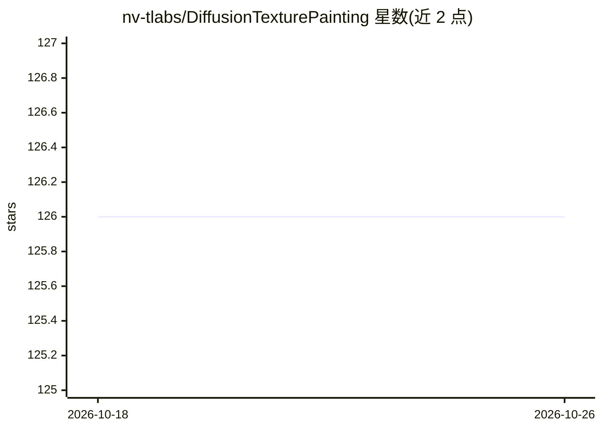

# nv-tlabs/DiffusionTexturePainting

⭐ 126 · Python · NOASSERTION · 推送 2026-01-16 · [GitHub](https://github.com/nv-tlabs/DiffusionTexturePainting) · [官网](https://research.nvidia.com/labs/toronto-ai/DiffusionTexturePainting/) · 组织维护

**SIGGRAPH 2024 论文：用扩散模型在 3D 网格表面交互式纹理绘制**

NVIDIA Research 的研究代码（SIGGRAPH 2024）：基于 2D 生成扩散模型，在 UV 映射的 3D 网格表面进行交互式纹理绘制。采用 stamp 方法将适配后的预训练 stable-diffusion inpainting 模型在局部渲染空间补绘，再投影回纹理图，笔刷可生成无缝笔迹与纹理间过渡。包含三部分：LoRA 微调训练脚本、TensorRT 推理（Docker 容器内运行、websocket 通信）、基于 Omniverse Kit 的绘制 App。仅验证于 Linux Ubuntu 20.04；原 runwayml 权重已下线，需改用替代模型源。供研究/商业询价需联系 NVIDIA Research Licensing。

## 筛选速览

| 维度 | 判定 | 备注 |
|---|---|---|
| AI 角色 | `ai-native` | 本体是模型或模型工具 |
| 许可风险 | `none` | NOASSERTION |
| 部署形态 | `self-host` | docker 或自建部署 |
| 模型依赖 | — | README 未给出锁定关系 |
| 硬件要求 | — | 无带数字的原话,不猜 |
| 安装摩擦 | `low` | 无编译、无系统依赖或容器化 |
| 成熟度 | — | 结构信号不足 |

## 能力要点

- 首例将扩散模型用于交互式纹理绘制的笔刷式方法
- LoRA 微调 stable-diffusion inpainting 模型支持图像条件
- TensorRT 加速推理，Docker 容器隔离，websocket 与绘制 App 通信
- 基于 Omniverse Kit 的 3D 网格纹理绘制应用

## 适用场景

- 艺术家在 3D 模型表面实时绘制复杂图像纹理
- 在已有纹理间生成真实感过渡与补绘
- 复现论文方法或开展生成式纹理研究

## 场景标签

`图像生成` · 领域:内容生成

## 证据(README 行号)

> L15: Abstract: *We present a technique that leverages 2D generative diffusion models (DMs) for interactive texture paint
> L48: This module accelerate the diffusion model inference speed using TensorRT. The model inference is isolated in a doc
> L107: The repository contains research code integrated into a kit application, based on the kit-app-template.

## 星数曲线

2026-10-18 126 → 2026-10-26 126（+0）

---
*卡片 v1 · prompt 1.4 · 生成 2026-10-23 · 置信度 high · 依据 README sha `8d92107b7c83` · [字段定义](../../DATASET.md)*
