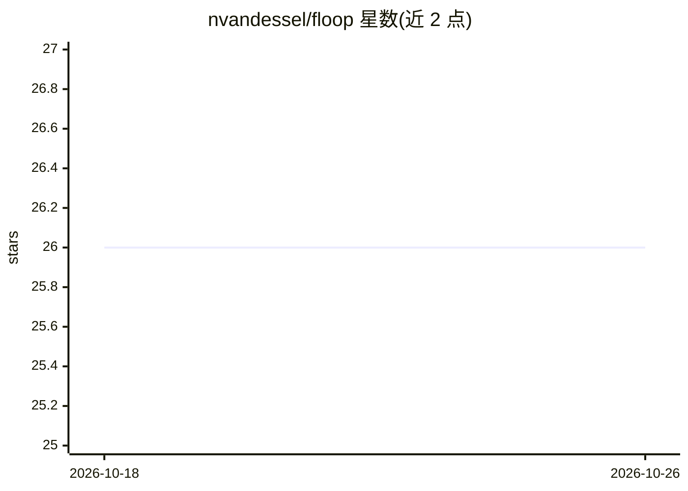

# nvandessel/floop

⭐ 26 · Go · Apache-2.0 · 推送 2026-07-31 · [GitHub](https://github.com/nvandessel/floop) · 个人维护

**AI 编码 agent 的记忆工具：把纠错固化为可复用行为**

面向 AI 编码 agent 的行为记忆系统：捕获用户对 agent 的纠正并提取为带上下文条件的行为规则，存入类型化边连接的图结构；会话开始时用 spreading activation 与本地 LanceDB 向量预筛，按文件类型、任务与语义相关性检索相关行为注入上下文。支持 Hebbian 学习强化连接、多 provider LLM 合并去重（OpenAI/Anthropic/Ollama），全局存储默认在 ~/.floop/，可选项目级存储。以 CLI 与 MCP server 两种形式接入 Claude Code、Cursor、Copilot 等 AI 工具；嵌入、LLM 合并与 LanceDB 均为可选，无外部依赖也可运行。作者声明为业余项目，CLI 与 MCP 接口稳定，内部实现可能在次版本间变化。

## 筛选速览

| 维度 | 判定 | 备注 |
|---|---|---|
| AI 角色 | `ai-ecosystem` | LLM/agent 周边工具 |
| 许可风险 | `permissive` | Apache-2.0 |
| 部署形态 | `library` | 以包/库形式分发 |
| 模型依赖 | local-ok | 支持本地模型 |
| 硬件要求 | — | 无带数字的原话,不猜 |
| 安装摩擦 | `low` | 无编译、无系统依赖或容器化 |
| 成熟度 | — | 结构信号不足 |

## 能力要点

- 纠错提取为行为规则，存入类型化边的图结构
- spreading activation + LanceDB 向量预筛的上下文感知检索
- 多 provider LLM 行为合并去重（OpenAI/Anthropic/Ollama）
- CLI 与 MCP server 双接口，--json 输出供 agent 消费

## 适用场景

- 让 AI 编码 agent 记住我在项目中的纠错偏好
- 跨项目维护全局行为库，按需附加项目级规则
- 通过 MCP 让 Claude Code/Cursor 等工具自动加载相关行为

## 场景标签

`Agent 记忆` · 领域:Agent 开发

## 证据(README 行号)

> L13: Every correction you give an AI agent is a lesson that dies at the end of the session. floop makes it stick.
> L28: - **MCP server** — Works with any AI tool that supports the Model Context Protocol
> L74: Add floop as an MCP server so your AI tool loads behaviors automatically.

## 星数曲线

2026-10-18 26 → 2026-10-26 26（+0）

---
*卡片 v1 · prompt 1.4 · 生成 2026-10-26 · 置信度 high · 依据 README sha `d2a4467f0447` · [字段定义](../../DATASET.md)*
