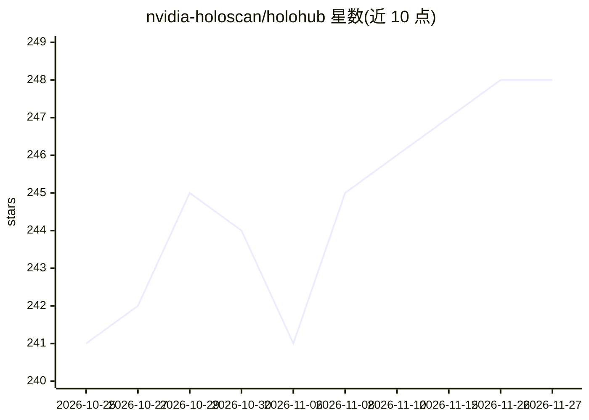

# nvidia-holoscan/holohub

⭐ 248 · Python · Apache-2.0 · 推送 2026-11-25 · [GitHub](https://github.com/nvidia-holoscan/holohub) · [官网](https://nvidia-holoscan.github.io/) · 组织维护

**NVIDIA Holoscan 生态的中央项目注册与索引仓库**

HoloHub 作为 Holoscan 生态的中央注册表，连接 SDK、应用、教程、基准测试、NVIDIA 模块、合作伙伴模块与归档源码仓库，提供 JSON 注册记录指向各项目源码 URL、Git 修订与目录。项目代码保留在各自仓库中，HoloHub 本身不含代码，配合 Holoscan CLI 完成发现、创建、构建、运行、测试与打包；社区成员可提交注册请求纳入项目。旧示例保留在 archive-4x 分支且已关闭新贡献。

## 筛选速览

| 维度 | 判定 | 备注 |
|---|---|---|
| AI 角色 | `ai-ecosystem` | LLM/agent 周边工具 |
| 许可风险 | `permissive` | Apache-2.0 |
| 部署形态 | `None` |  |
| 模型依赖 | — | README 未给出锁定关系 |
| 硬件要求 | — | 无带数字的原话,不猜 |
| 安装摩擦 | `low` | 无编译、无系统依赖或容器化 |
| 成熟度 | — | 结构信号不足 |

## 能力要点

- 以 JSON 注册记录索引生态项目（源码 URL、Git ref、可选目录）
- 连接 SDK/应用/教程/基准/模块/归档等生态仓库
- 配合 Holoscan CLI 发现、构建、运行与打包项目
- 合作伙伴与社区成员可注册自己的项目

## 适用场景

- 查找并运行 Holoscan 生态的加速传感与 AI 流水线应用
- 复用已注册的算子模块到自己的应用
- 使用编码代理技能辅助 Holoscan 开发
- 为 Holoscan 生态注册或贡献自己的项目

## 场景标签

 · 领域:AI 基础设施/传感器处理生态

## 证据(README 行号)

> L3: HoloHub is the central registry for the NVIDIA Holoscan
> L4: ecosystem. Find applications, reusable modules, tutorials, benchmarks, and agent
> L38: |**Holoscan CLI**|Discover, create, build, run, test, and package supported projects using their configuration.|

## 星数曲线

2026-10-25 241 → 2026-11-27 248（+7）

---
*卡片 v1 · prompt 1.4 · 生成 2026-11-25 · 置信度 mid · 依据 README sha `73f17d5f7651` · [字段定义](../../DATASET.md)*
