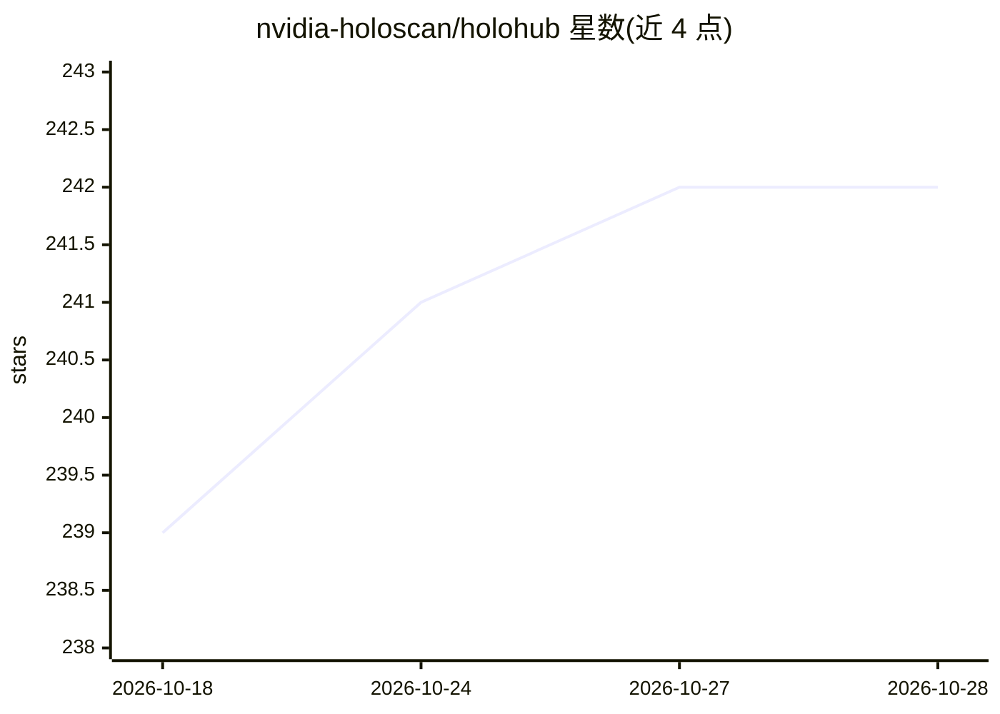

# nvidia-holoscan/holohub

⭐ 245 · Python · 推送 2026-10-23 · [GitHub](https://github.com/nvidia-holoscan/holohub) · [官网](https://nvidia-holoscan.github.io/) · 组织维护

**NVIDIA Holoscan 生态的中央注册中心与项目枢纽**

由 NVIDIA 维护的 Holoscan 生态聚合中心：收录围绕 Holoscan SDK 的应用、教程、性能基准、可复用模块源与面向编码 agent 的技能源，各项内容在各自独立仓库中维护，HoloHub 以来源记录方式指向其位置、版本与目录。用户按来源记录跳转至目标仓库阅读其 README，自行完成安装、构建与运行；SDK 与硬件要求因项目而异。原代码合集保留在 archive-4x 分支且已停止接受新贡献。

## 筛选速览

| 维度 | 判定 | 备注 |
|---|---|---|
| AI 角色 | `ai-knowledge` | 知识聚合/清单类 |
| 许可风险 | `none` | — |
| 部署形态 | `None` |  |
| 模型依赖 | — | README 未给出锁定关系 |
| 硬件要求 | — | 无带数字的原话,不猜 |
| 安装摩擦 | `low` | 无编译、无系统依赖或容器化 |
| 成熟度 | — | 结构信号不足 |

## 能力要点

- 按用途索引生态内容：应用、教程、基准、模块源、技能源
- 来源记录指向各项目仓库的位置、revision 与目录
- archive-4x 分支保留早期代码合集，已关闭新贡献

## 适用场景

- 寻找可运行或可改造的 Holoscan 加速传感处理应用
- 按教程学习 Holoscan 开发概念与流程
- 查找性能基准结果或可复用的 operator 模块
- 为编码 agent 查找 Holoscan 相关技能资源

## 场景标签

`精选清单` · 领域:学习与行业

## 证据(README 行号)

> L3: HoloHub is the central registry and hub for the ecosystem built around the NVIDIA Holoscan SDK.
> L4: Use it to find applications, reusable modules, tutorials, benchmarks,

## 星数曲线

2026-10-18 239 → 2026-10-28 242（+3）

---
*卡片 v1 · prompt 1.4 · 生成 2026-10-22 · 置信度 high · 依据 README sha `472bcd36e0c5` · [字段定义](../../DATASET.md)*
