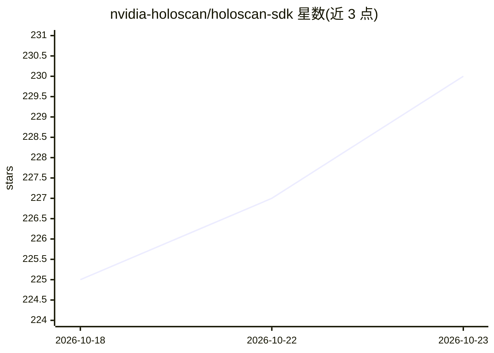

# nvidia-holoscan/holoscan-sdk

⭐ 230 · C++ · Apache-2.0 · 推送 2026-10-21 · [GitHub](https://github.com/nvidia-holoscan/holoscan-sdk) · [官网](https://www.holoscan.org) · 组织维护

**NVIDIA 的低延迟传感器流式 AI 管线构建 SDK**

Holoscan SDK 是 NVIDIA Holoscan 平台的 C++/Python SDK，用于在嵌入式、边缘到云端构建流式 AI 管线，覆盖医疗设备、边缘高性能计算、工业检测等领域。提供 NGC 容器、Debian 包、Python wheel 三种安装方式，也可从源码构建；运行测试套件需通过 NVIDIA Container Toolkit 获得 GPU 访问。SDK 内含可选模块（推理、视觉、可视化）、示例与 FlatBuffers schema，附带 HoloHub 社区组件生态，另发布供 AI 编码助手使用的 skills。Apache-2.0 许可。

## 筛选速览

| 维度 | 判定 | 备注 |
|---|---|---|
| AI 角色 | `ai-ecosystem` | LLM/agent 周边工具 |
| 许可风险 | `permissive` | Apache-2.0 |
| 部署形态 | `library` | 以包/库形式分发 |
| 模型依赖 | — | README 未给出锁定关系 |
| 硬件要求 | — | 无带数字的原话,不猜 |
| 安装摩擦 | `medium` | 含编译或系统依赖之一 |
| 成熟度 | — | 结构信号不足 |

## 能力要点

- C++/Python SDK，构建从嵌入式到云的流式 AI 管线
- 可选模块含 Inference、Vision、Visualization
- NGC 容器 / Debian 包 / Python wheel 三种分发方式
- 发布可经 npx skills CLI 安装的 AI 编码助手技能

## 适用场景

- 构建医疗设备的低延迟传感器流处理应用
- 开发边缘工业检测的 AI 管线
- 在 GPU 环境下搭建高性能边缘流式工作流

## 场景标签

 · 领域:边缘AI/流式传感器处理

## 证据(README 行号)

> L3: The **Holoscan SDK** is part of NVIDIA Holoscan, the AI sensor processing platform that combines hardware systems fo
> L22: - An introduction to the NVIDIA Holoscan platform, including the Holoscan C++/Python SDK;

## 星数曲线

2026-10-18 225 → 2026-10-23 230（+5）

---
*卡片 v1 · prompt 1.4 · 生成 2026-10-22 · 置信度 mid · 依据 README sha `70dc9dc022a4` · [字段定义](../../DATASET.md)*
