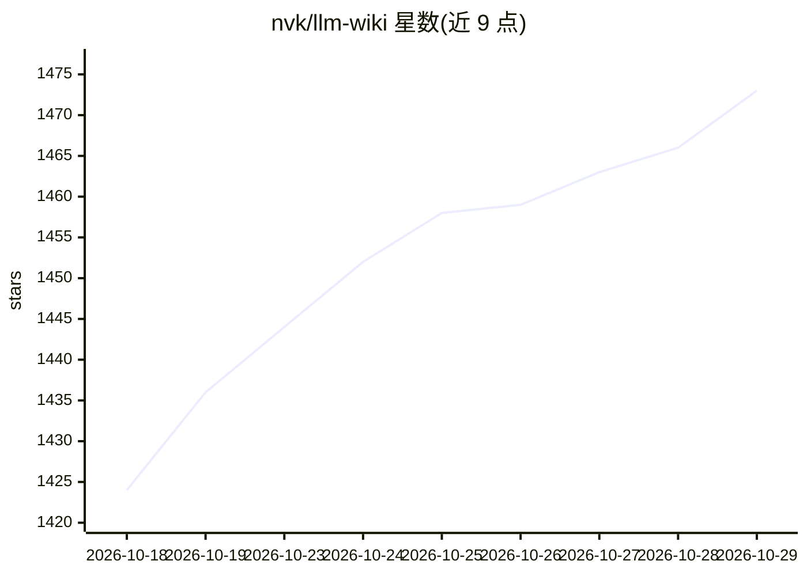

# nvk/llm-wiki

⭐ 1,473 · Python · MIT · 推送 2026-10-25 · [GitHub](https://github.com/nvk/llm-wiki) · [官网](https://llm-wiki.net/) · 个人维护

**为 AI agent 提供 LLM 编译知识库的技能/插件包**

面向 Claude Code、OpenAI Codex、OpenCode、Pi 及任意 LLM agent 的插件与指令文件包，用于构建和维护 LLM 编译的知识库（wiki）：支持并行多 agent 研究、来源摄取、wiki 编译、审计、查询与工件生成，并提供会话记忆与 collector 目录。行为层以 Claude 插件为事实源，经脚本生成各运行时打包；提供只读查询 profile 与完整写入 profile 两种模式，数据目录兼容 Obsidian，支持 iCloud 共享 hub 与 nono 沙箱权限配置。

## 筛选速览

| 维度 | 判定 | 备注 |
|---|---|---|
| AI 角色 | `ai-ecosystem` | LLM/agent 周边工具 |
| 许可风险 | `permissive` | MIT |
| 部署形态 | `None` |  |
| 模型依赖 | locked-api |  |
| 硬件要求 | — | 无带数字的原话,不猜 |
| 安装摩擦 | `low` | 无编译、无系统依赖或容器化 |
| 成熟度 | — | 结构信号不足 |

## 能力要点

- 并行多 agent 研究、来源摄取、wiki 编译与审计的完整工作流
- 多运行时分发：Claude Code 原生插件、Codex marketplace、OpenCode/Pi 指令文件、可移植 AGENTS.md
- 只读 query-lite profile（约 2.8 KB）与完整写入协议分层
- 从 Claude 源同步生成各运行时包并用测试脚本检测漂移

## 适用场景

- 让 Claude Code / Codex 等 agent 维护项目知识库并按需查询
- 将想法经研究流程固化为可审计的 wiki 条目
- 跨多个 agent 运行时共享同一套知识库行为协议

## 场景标签

`知识库管理` · 领域:知识与检索

## 证据(README 行号)

> L12: LLM-compiled knowledge bases for any AI agent. Capture rough Ideas, research and shape them, then explicitly promot
> L161: ## Claude-First, Multi-Runtime
> L165: - `claude-plugin/` is the primary distribution target and UX surface.

## 星数曲线

2026-10-18 1,424 → 2026-10-29 1,473（+49）

---
*卡片 v1 · prompt 1.4 · 生成 2026-10-21 · 置信度 high · 依据 README sha `580fc79c0124` · [字段定义](../../DATASET.md)*
