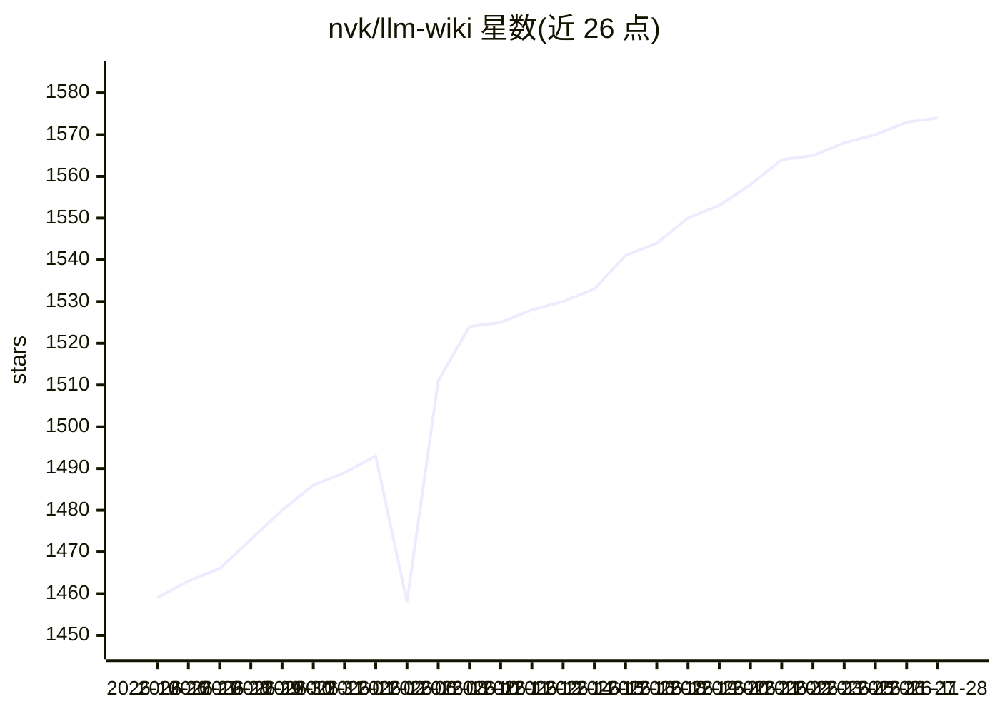

# nvk/llm-wiki

⭐ 1,574 · Python · MIT · 推送 2026-10-25 · [GitHub](https://github.com/nvk/llm-wiki) · [官网](https://llm-wiki.net/) · 个人维护

**为 AI agent 编译知识库的多运行时插件/技能包**

一套以指令文件和技能文件形式分发的 agent 工作流：将粗略想法经研究整理为 brief，再提升为交付项目，支持并行多 agent 研究、来源摄取、wiki 编译、只读查询与工件生成。按不同运行时分别打包为 Claude Code 原生插件、OpenAI Codex 插件、DeepSeek Harness 文件系统技能、OpenCode 指令文件、Pi 技能及可移植 AGENTS.md；行为层以 Claude 版本为源真值，其他运行时包由脚本生成，输出与 Obsidian 兼容。

## 筛选速览

| 维度 | 判定 | 备注 |
|---|---|---|
| AI 角色 | `ai-native` | 本体是模型或模型工具 |
| 许可风险 | `permissive` | MIT |
| 部署形态 | `None` |  |
| 模型依赖 | locked-api |  |
| 硬件要求 | — | 无带数字的原话,不猜 |
| 安装摩擦 | `low` | 无编译、无系统依赖或容器化 |
| 成熟度 | — | 结构信号不足 |

## 能力要点

- 覆盖五个运行时（Claude Code/Codex/DeepSeek Harness/OpenCode/Pi）加任意 agent 的可移植协议
- 只读 query-lite 档案（约 2.8 KB）与完整研究维护档案分离
- 运行时镜像包由同步脚本从 Claude 源真值生成，并用测试脚本检查漂移
- 支持本地模型（Pi + DS4 启动器）与 iCloud 共享 hub 路径配置

## 适用场景

- 让编码 agent 长期维护一个可查询的项目/领域 wiki
- 把零散想法经多 agent 研究整理为可执行的 brief 与项目
- 在本地模型 agent 上以只读方式查询已编译的知识库

## 场景标签

`知识库管理` · 领域:知识与检索

## 证据(README 行号)

> L16: LLM-compiled knowledge bases for any AI agent. Capture rough Ideas, research and shape them, then explicitly promot
> L171: **Any LLM Agent** (portable instruction file):
> L186: Claude Code is the principal user. Keep one shared behavior layer and thin packaging layers per runtime:

## 星数曲线

2026-10-26 1,459 → 2026-11-28 1,574（+115）

---
*卡片 v1 · prompt 1.4 · 生成 2026-11-23 · 置信度 mid · 依据 README sha `e38731da3f05` · [字段定义](../../DATASET.md)*
