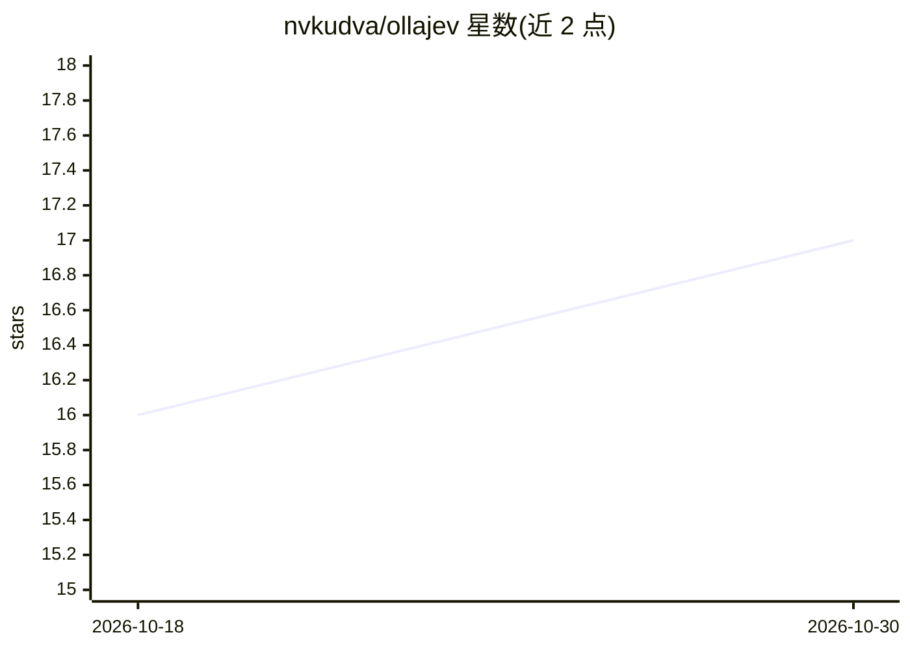

# nvkudva/ollajev

⭐ 17 · Python · Apache-2.0 · 推送 2026-10-29 · [GitHub](https://github.com/nvkudva/ollajev) · 个人维护

**本地运行 System One 决策模型的 Ollama 式运行时服务**

在本地机器上运行来自 Hugging Face 的 System One 决策模型，通过 /v1/systemone API（与 TypeSafe 的 Jev 同格式）提供服务。发送一个状态与若干类型化问题，一次前向推理返回每个问题的校准概率；支持图像/音频/视频输入（视模型而定）。提供 Ollama 风格命令（pull/list/run/serve/ps/rm）、终端模型管理器与浏览器 playground，兼容 typesafe-sdk（改 TYPESAFE_BASE_URL 即可）。安装时编译 llama.cpp，模型经 PyTorch、llama.cpp 或 MLX（Apple Silicon）运行。默认仅绑定 127.0.0.1。

## 筛选速览

| 维度 | 判定 | 备注 |
|---|---|---|
| AI 角色 | `ai-ecosystem` | LLM/agent 周边工具 |
| 许可风险 | `permissive` | Apache-2.0 |
| 部署形态 | `library` | 以包/库形式分发 |
| 模型依赖 | local-ok | 支持本地模型 |
| 硬件要求 | — | 无带数字的原话,不猜 |
| 安装摩擦 | `high` | 编译与系统依赖俱全 |
| 成熟度 | — | 结构信号不足 |

## 能力要点

- 一次前向输出各类型化问题的校准概率（noul/choice/score）
- Ollama 风格 CLI：pull/list/run/serve/ps/rm 与模型管理器、playground
- typesafe-sdk 兼容：同路由同请求/响应格式，改 TYPESAFE_BASE_URL 即可接入
- 模型经 PyTorch/llama.cpp/MLX 运行，支持图像、音频、视频输入（视模型）

## 适用场景

- 本地部署决策模型并通过 Jev / System One API 调用
- 用 typesafe-sdk 的应用切换到本地推理后端
- 在浏览器 playground 中对比多个决策模型对同一状态的回答

## 场景标签

`推理引擎` · 领域:训练与推理

## 证据(README 行号)

> L6: Run System One decision models from Hugging Face on your machine, behind the same <code>/v1/systemone</code> API as 
> L19: - **Ollama-style workflow:** `pull`, `list`, `run`, `serve`, `ps`, `rm`, plus a terminal model manager and a browse
> L20: - **Drop-in for `typesafe-sdk`:** point `TYPESAFE_BASE_URL` at it; same routes, same request and response shapes.

## 星数曲线

2026-10-18 16 → 2026-10-30 17（+1）

---
*卡片 v1 · prompt 1.4 · 生成 2026-10-30 · 置信度 high · 依据 README sha `3c7756610753` · [字段定义](../../DATASET.md)*
