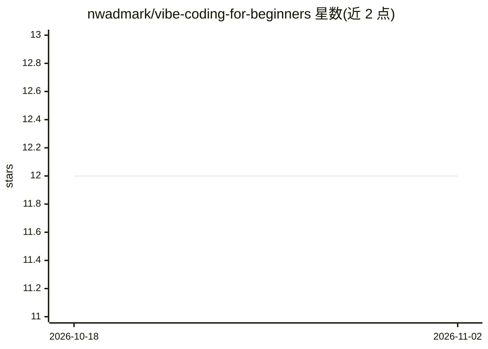

# nwadmark/vibe-coding-for-beginners

⭐ 12 · Python · MIT · 推送 2026-03-01 · [GitHub](https://github.com/nwadmark/vibe-coding-for-beginners) · 个人维护

**面向零基础产品经理的 60-75 分钟 AI 辅助编程实战工作坊教材**

一套动手工作坊教学材料：参与者在 Claude.ai 或 ChatGPT 免费版与浏览器端 Replit 环境下，通过写提示词让 AI 生成代码，从零完成一个 Python 产品管理工具（Decision Framework，加权评分决策框架）。仓库另提供 7 个进阶项目教程（优先级排序、队列分析、A/B 计算器等）、可复制的提示词库、引导者手册与自助/直播/企业培训三种开展格式。所有工具均有免费选项，付费升级非必需。

## 筛选速览

| 维度 | 判定 | 备注 |
|---|---|---|
| AI 角色 | `ai-knowledge` | 知识聚合/清单类 |
| 许可风险 | `permissive` | MIT |
| 部署形态 | `None` |  |
| 模型依赖 | — | README 未给出锁定关系 |
| 硬件要求 | — | 无带数字的原话,不猜 |
| 安装摩擦 | `low` | 无编译、无系统依赖或容器化 |
| 成熟度 | — | 结构信号不足 |

## 能力要点

- 60-75 分钟从零完成一个可用 Python PM 工具的引导式流程
- 7 个附加项目教程（RICE 优先级、队列留存、A/B 显著性计算等）
- prompts/ 目录提供可直接复制的 AI 编程助手提示词库
- 面向团队/聚会/课堂的 facilitator 讲义与计时指南

## 适用场景

- 零基础产品经理完成第一个编程项目
- PM 团队内部开展 AI 工具上手培训
- 自学者按参考库节奏逐个搭建 PM 工具

## 场景标签

`教程课程` · 领域:学习与行业

## 证据(README 行号)

> L29: A hands-on workshop where product managers build real tools using free AI coding assistants. You will write prompts
> L53: **🎓 Live Workshop (60-75 minutes)**

## 星数曲线

2026-10-18 12 → 2026-11-02 12（+0）

---
*卡片 v1 · prompt 1.4 · 生成 2026-11-01 · 置信度 high · 依据 README sha `b11435d51fc7` · [字段定义](../../DATASET.md)*
