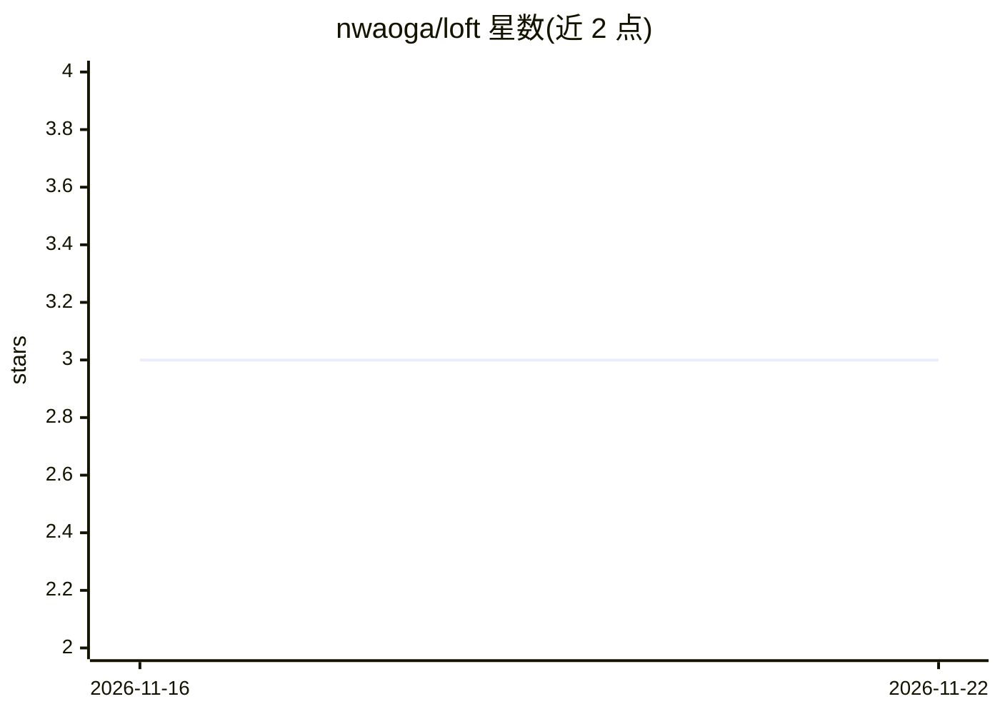

# nwaoga/loft

⭐ 3 · Rust · MIT · 推送 2026-11-16 · [GitHub](https://github.com/nwaoga/loft) · 个人维护

**本地文件离线问答的桌面条应用，答案带出处引用**

以 Rust + Tauri + Svelte 构建的桌面应用，UI 呈现为屏幕顶部的 notch 胶囊窗口。用户选择文件夹或拖入文件后，应用解析文本/代码/PDF/Office 文件并建立可增量更新的本地索引；提问时由两个本地 llama-server 进程（聊天与嵌入各一）完成检索与生成，返回最多约 6 KB 上下文来源的答案，附可点击打开原文的来源抽屉。问答全程不调用云 API，无需 API key。Windows 提供安装包，macOS/Linux 需从源码构建。

## 筛选速览

| 维度 | 判定 | 备注 |
|---|---|---|
| AI 角色 | `ai-native` | 本体是模型或模型工具 |
| 许可风险 | `permissive` | MIT |
| 部署形态 | `desktop` | 安装包/桌面程序 |
| 模型依赖 | local-ok | 支持本地模型 |
| 硬件要求 | — | 无带数字的原话,不猜 |
| 安装摩擦 | `low` | 无编译、无系统依赖或容器化 |
| 成熟度 | — | 结构信号不足 |

## 能力要点

- 两个本地 llama.cpp 服务进程离线完成聊天与嵌入
- 答案附来源抽屉，PDF 可定位到被引用页
- 内置模型目录下载并做 SHA-256 校验（聊天/嵌入/可选图片描述模型）
- CPU/Vulkan/Metal 随附，CUDA 与 OpenVINO 可选安装，支持 NPU 实验

## 适用场景

- 对本地文件夹中的文档离线提问并获得带出处的答案
- 在不联网、不调用云 API 的环境下索引与检索私人文件
- 在笔记本上按电源状态自动切换 GPU 与 CPU 推理

## 场景标签

`RAG` `文档问答` · 领域:知识与检索

## 证据(README 行号)

> L14:  A local RAG notch that answers questions about the files in folders you choose — fully offline, on llama.cpp.
> L61: Loft runs llama.cpp on this computer. A question does not call a cloud API and does not need an API key. Two local 

## 星数曲线

2026-11-16 3 → 2026-11-22 3（+0）

---
*卡片 v1 · prompt 1.4 · 生成 2026-11-21 · 置信度 high · 依据 README sha `8655ca9d2ced` · [字段定义](../../DATASET.md)*
