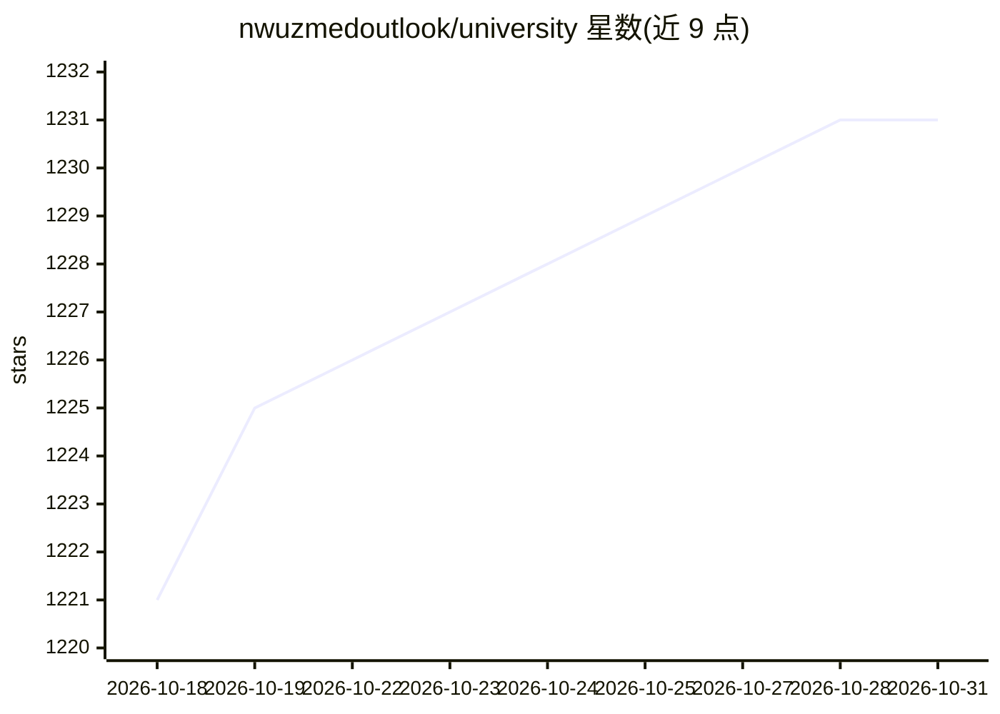

# nwuzmedoutlook/university

⭐ 1,231 · Apache-2.0 · 推送 2026-09-28 · [GitHub](https://github.com/nwuzmedoutlook/university) · [官网](https://workhard.eu.org) · 个人维护 · 中文 README

**120+ 所国内高校课程资源链接的手工整理清单**

以表格形式收录清华大学、北京大学、浙江大学等 120 余所国内高校的课程资料链接，条目覆盖课程攻略共享计划、期末试题、考研与保研资料、复习笔记等，以计算机类专业为主，兼含电子、自动化、精算、生物医学工程等方向。资源以 GitHub/Gitee 仓库及站点链接形式给出，通过 Pull Requests 接受补充与修订。清单本身不含课件内容，仅做索引与导航。

## 筛选速览

| 维度 | 判定 | 备注 |
|---|---|---|
| AI 角色 | `ai-knowledge` | 知识聚合/清单类 |
| 许可风险 | `permissive` | Apache-2.0 |
| 部署形态 | `None` |  |
| 模型依赖 | — | README 未给出锁定关系 |
| 硬件要求 | — | 无带数字的原话,不猜 |
| 安装摩擦 | `low` | 无编译、无系统依赖或容器化 |
| 成熟度 | — | 结构信号不足 |

## 能力要点

- 按学校名称与学校类型（985/211/双一流）分组的表格索引
- 覆盖 120+ 所高校，以计算机类课程资源为主
- 通过 Pull Requests 接受社区补充与修订

## 适用场景

- 按学校查找课程攻略、笔记与期末试题仓库
- 考研、保研备考时收集目标院校资料
- 对比各校课程资源共享项目的入口

## 场景标签

`精选清单` · 领域:学习与行业

## 证据(README 行号)

> L1: # 📚各大高校课程资源汇总，在Github上大学&emsp;&emsp;&emsp;&emsp;💡加入组织
> L7: |序号|学校名称|学校类型|课程资源链接|
> L9: |1|清华大学|Top|计算机系课程攻略 https://github.com/Salensoft/thu-cst-cracker https://github.com/PKUanonym/REKCARC-TSC-UHT https

## 星数曲线

2026-10-18 1,221 → 2026-10-31 1,231（+10）

---
*卡片 v1 · prompt 1.4 · 生成 2026-10-21 · 置信度 high · 依据 README sha `10eeb20371cc` · [字段定义](../../DATASET.md)*
