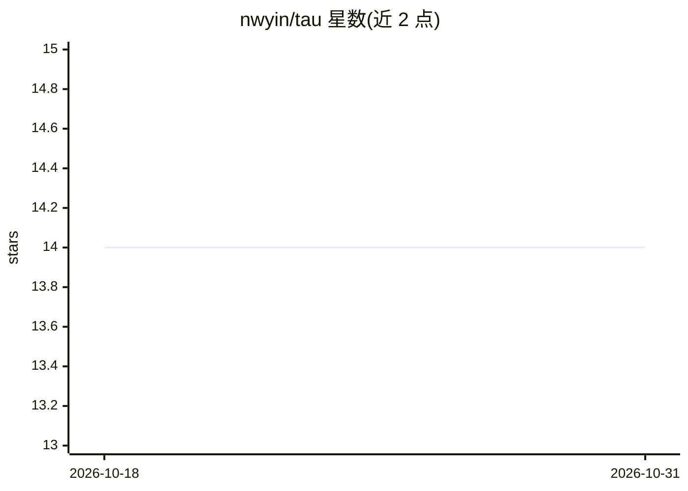

# nwyin/tau

⭐ 14 · Rust · MIT · 推送 2026-04-24 · [GitHub](https://github.com/nwyin/tau) · 个人维护

**Rust 编写的极简可定制编码 agent 框架，含 TUI/CLI/serve 模式**

用 Rust 实现的编码 agent harness：提供全屏 TUI、无头 --prompt 模式与 JSON-RPC serve 模式三种运行方式。分层架构中 ai 层负责 provider 适配与流式原语，agent 层为通用运行时（上下文压缩、编排），coding-agent 为内置编码工具集（文件编辑、shell、搜索、web、子代理、Python REPL）。支持工具权限（allow/deny/ask）、会话持久化、结构化 trace 捕获与 .tau/skills/ 技能发现。接入 Anthropic、OpenAI Responses 与 OpenAI 兼容后端，经环境变量认证。可从源码编译（Rust 1.75+）或下载预编译 Linux 静态二进制。

## 筛选速览

| 维度 | 判定 | 备注 |
|---|---|---|
| AI 角色 | `ai-ecosystem` | LLM/agent 周边工具 |
| 许可风险 | `permissive` | MIT |
| 部署形态 | `None` |  |
| 模型依赖 | locked-api |  |
| 硬件要求 | — | 无带数字的原话,不猜 |
| 安装摩擦 | `low` | 无编译、无系统依赖或容器化 |
| 成熟度 | — | 结构信号不足 |

## 能力要点

- TUI / headless CLI / JSON-RPC serve 三种运行模式
- 内置文件、shell、搜索、web、子代理与持久 Python REPL 工具
- 工具权限体系（allow/deny/ask）与 --yolo 自动批准
- 会话持久化、resume 与始终开启的结构化 trace 捕获

## 适用场景

- 在终端中通过 TUI 或 CLI 进行 AI 辅助编码
- 用 --prompt 无头模式做脚本化调用与基准评测
- 通过 serve 模式以 JSON-RPC 编排多个 agent 线程

## 场景标签

`编码 Agent` · 领域:编码与开发

## 证据(README 行号)

> L3: A Rust coding-agent harness with a full-screen TUI, headless CLI, JSON-RPC serve mode, reusable worker threads, and 
> L9: agent          generic agent runtime, context compaction, stats, orchestration
> L10: coding-agent   tau binary: TUI/CLI/serve modes, tools, permissions, sessions, traces

## 星数曲线

2026-10-18 14 → 2026-10-31 14（+0）

---
*卡片 v1 · prompt 1.4 · 生成 2026-10-31 · 置信度 high · 依据 README sha `90024ac8cc81` · [字段定义](../../DATASET.md)*
