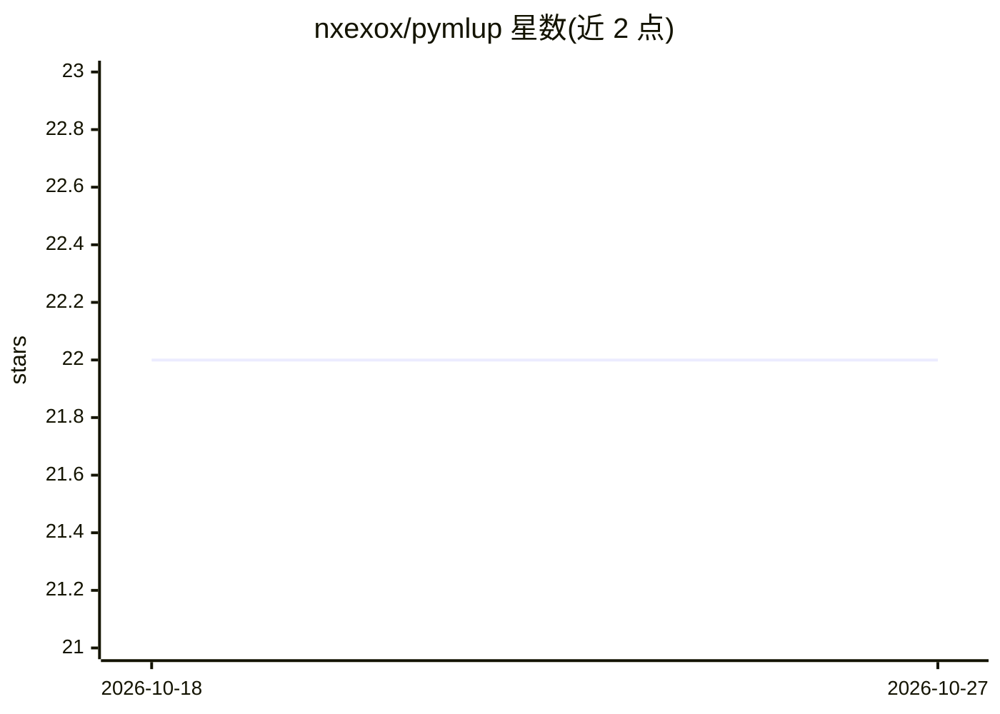

# nxexox/pymlup

⭐ 22 · Python · MIT · 推送 2026-09-02 · [GitHub](https://github.com/nxexox/pymlup) · [官网](https://mlup.org) · 个人维护

**把 Python ML 模型一键转成 FastAPI 服务的框架**

MLup 将 Python 对象或已序列化的机器学习模型（pickle/joblib/PyTorch/TensorFlow/ONNX/LightGBM 等）自动生成为可自托管的 FastAPI REST 服务：mlup run 命令即可启动，提供 POST /predict、基于模型签名的请求校验、自动 OpenAPI 文档、/health 与 /info 端点，另支持 worker_and_queue 与 batching 执行模式。面向已有模型、只需干净 HTTP 服务层的开发者；README 明确不覆盖 K8s 自动扩缩、多 GPU 推理与完整 MLOps 生命周期。

## 筛选速览

| 维度 | 判定 | 备注 |
|---|---|---|
| AI 角色 | `ai-ecosystem` | LLM/agent 周边工具 |
| 许可风险 | `permissive` | MIT |
| 部署形态 | `library` | 以包/库形式分发 |
| 模型依赖 | — | README 未给出锁定关系 |
| 硬件要求 | — | 无带数字的原话,不猜 |
| 安装摩擦 | `low` | 无编译、无系统依赖或容器化 |
| 成熟度 | — | 结构信号不足 |

## 能力要点

- mlup run 命令从序列化模型直接生成 FastAPI 服务
- POST /predict 自动校验、OpenAPI 文档、/health 与 /info 端点
- 支持 sklearn/LightGBM/PyTorch/TensorFlow/ONNX 及任意带 predict 方法的 Python 对象
- 可选 worker_and_queue 与 batching 执行模式

## 适用场景

- 把已训练的模型快速暴露为内部 HTTP API
- 将 notebook 里的原型模型变成可访问的 REST 服务
- 不引入完整 MLOps 平台时做小规模自托管模型服务

## 场景标签

`推理引擎` · 领域:训练与推理

## 证据(README 行号)

> L3: **MLup turns Python objects and serialized machine learning models into self-hosted FastAPI REST APIs without writin
> L5: Serve sklearn, PyTorch, TensorFlow, ONNX, and custom Python models through a generated FastAPI application with vali

## 星数曲线

2026-10-18 22 → 2026-10-27 22（+0）

---
*卡片 v1 · prompt 1.4 · 生成 2026-10-27 · 置信度 high · 依据 README sha `0070ac76fe05` · [字段定义](../../DATASET.md)*
