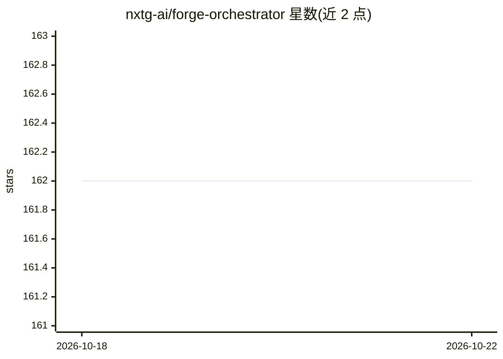

# nxtg-ai/forge-orchestrator

⭐ 162 · Rust · NOASSERTION · 推送 2026-10-15 · [GitHub](https://github.com/nxtg-ai/forge-orchestrator) · [官网](https://forge.nxtg.ai) · 组织维护

**面向 Claude Code 的多 AI 编码工具任务编排 MCP 服务器**

用 Rust 编写的单二进制 MCP 服务器与编排器，用于多个 AI 编码工具共享同一代码仓库时的协同：提供文件独占锁（含超时与死锁检测）、跨工具知识捕获（.forge/knowledge/）、规格到依赖任务图的计划生成、漂移检测（需 openai brain，默认规则 brain 不计分）、TUI 仪表盘与 CI 无头模式 forge run。Claude Code 通过 MCP stdio 接入，Codex CLI 与 Antigravity CLI 作为任务运行器；状态全部存于 .forge/ 文件目录，无守护进程、无数据库。声明为 alpha 阶段，FSL-1.1-ALv2 许可（2028-03-18 转 Apache 2.0），接口可能变更。通过 curl 安装脚本安装固定版本。

## 筛选速览

| 维度 | 判定 | 备注 |
|---|---|---|
| AI 角色 | `ai-ecosystem` | LLM/agent 周边工具 |
| 许可风险 | `none` | NOASSERTION |
| 部署形态 | `library` | 以包/库形式分发 |
| 模型依赖 | locked-api |  |
| 硬件要求 | — | 无带数字的原话,不猜 |
| 安装摩擦 | `low` | 无编译、无系统依赖或容器化 |
| 成熟度 | `idea` | |

## 能力要点

- 12 工具 MCP 服务器，任何接入的 AI 客户端可创建/认领/完成任务
- 文件独占锁含超时与死锁检测，覆盖多适配器并发访问
- 跨工具知识飞轮：决策与模式自动分类并可跨会话检索
- forge run 无头模式用于 CI/CD 自主执行

## 适用场景

- 多个 AI 编码工具在同一仓库上协作时避免冲突编辑
- 把规格文档分解为依赖任务图并分派给不同工具
- CI 流水线中无人值守执行任务
- 跨会话、跨工具沉淀与检索项目决策知识

## 场景标签

 · 领域:开发者工具/AI 编排

## 证据(README 行号)

> L9: **Orchestration for Claude Code on shared repos, with Codex CLI and Antigravity CLI (`agy`) as task runners — single
> L13: It adds file locking, knowledge capture, task planning, drift detection, and multi-tool orchestration to your devel
> L91: |Multi-tool adapters|Claude Code (MCP stdio); Codex CLI and Antigravity CLI (`agy`) as task runners (filesystem). C

## 星数曲线

2026-10-18 162 → 2026-10-22 162（+0）

---
*卡片 v1 · prompt 1.4 · 生成 2026-10-22 · 置信度 mid · 依据 README sha `257ffbc2315f` · [字段定义](../../DATASET.md)*
