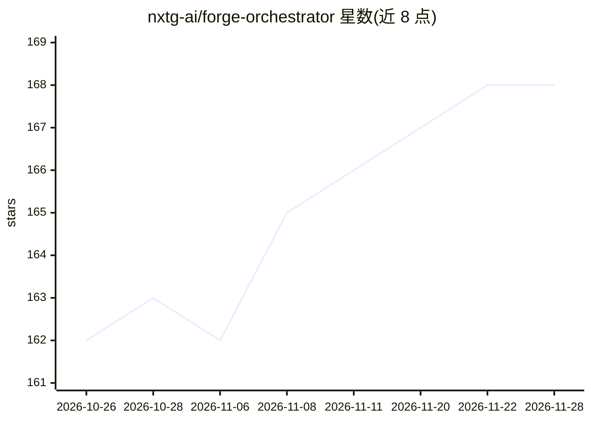

# nxtg-ai/forge-orchestrator

⭐ 168 · Rust · Apache-2.0 · 推送 2026-11-27 · [GitHub](https://github.com/nxtg-ai/forge-orchestrator) · [官网](https://forge.nxtg.ai) · 组织维护

**为 Claude Code 提供共享仓库多工具任务编排的 MCP 服务器**

单二进制 Rust 编排器，通过 12 工具 MCP 服务器为 Claude Code 提供共享状态层：文件锁（任务声明所触文件、claim 时检查重叠）、知识库（决策/模式自动分类可检索）、规格到任务图的计划生成、任务板与漂移检测（需 openai brain）。Codex CLI 与 Antigravity CLI（agy）作为任务运行器接入，TUI 面板与 headless 模式支持 CI。Alpha 阶段，无 SLA，接口可能变更；锁仅约束 claim 不阻止写入，无超时机制。

## 筛选速览

| 维度 | 判定 | 备注 |
|---|---|---|
| AI 角色 | `ai-ecosystem` | LLM/agent 周边工具 |
| 许可风险 | `none` | Apache-2.0 |
| 部署形态 | `library` | 以包/库形式分发 |
| 模型依赖 | — | README 未给出锁定关系 |
| 硬件要求 | — | 无带数字的原话,不猜 |
| 安装摩擦 | `low` | 无编译、无系统依赖或容器化 |
| 成熟度 | `idea` | |

## 能力要点

- 12 工具 MCP server（stdio），任何连接的 AI 客户端可创建/认领/完成任务
- 文件锁：任务声明所触文件，claim 冲突时拒绝并指明持锁任务
- 知识飞轮：捕获决策/模式/经验，自动分类并可跨会话检索
- 单二进制、零运行时依赖；状态以 .forge/ 文件存储，无守护进程无数据库

## 适用场景

- 多个 AI 编码工具在同一仓库协作时避免相互覆盖
- 将任务规划与执行纳入 CI/CD 的 headless 流水线
- 在团队开发中沉淀与检索跨工具的决策与经验

## 场景标签

`编码 Agent` `Agent 框架` `多智能体` `知识库管理` · 领域:Agent 开发

## 证据(README 行号)

> L9: **Orchestration for Claude Code on shared repos, with Codex CLI and Antigravity CLI (`agy`) as task runners — single
> L13: It adds file locking, knowledge capture, task planning, drift detection, and multi-tool orchestration to your devel
> L94: |MCP server|12 tools accessible by any connected AI tool via stdio, including `forge_create_task`|

## 星数曲线

2026-10-26 162 → 2026-11-28 168（+6）

---
*卡片 v1 · prompt 1.4 · 生成 2026-11-26 · 置信度 mid · 依据 README sha `0a5c0bc24d44` · [字段定义](../../DATASET.md)*
