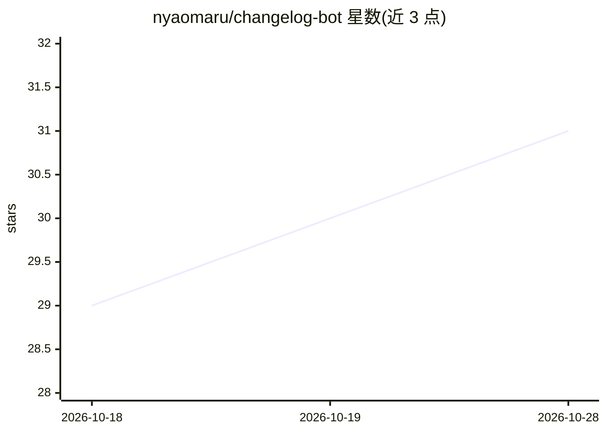

# nyaomaru/changelog-bot

⭐ 31 · TypeScript · MIT · 推送 2026-10-27 · [GitHub](https://github.com/nyaomaru/changelog-bot) · 个人维护

**用 LLM 从 Git 历史与 PR 自动生成 changelog 的 CLI/GitHub Action**

面向维护者和发布负责人的变更日志生成工具：读取 commit 历史、PR 标题与 release notes，可选调用 OpenAI/Anthropic/Gemini/xAI 生成 changelog 条目并自动开 PR，无 API key 时回退到基于 git log 的启发式确定性输出。提供 CLI、GitHub Action 与可复用 workflow 三种用法，支持自定义指令文件、多语言输出、WHY 原因抽取（LLM 或实验性 Jev 引擎）。项目自述处于 v0.0.x 早期阶段，接口可能变动，建议生产使用时锁定版本。

## 筛选速览

| 维度 | 判定 | 备注 |
|---|---|---|
| AI 角色 | `ai-native` | 本体是模型或模型工具 |
| 许可风险 | `permissive` | MIT |
| 部署形态 | `library` | 以包/库形式分发 |
| 模型依赖 | locked-api |  |
| 硬件要求 | — | 无带数字的原话,不猜 |
| 安装摩擦 | `low` | 无编译、无系统依赖或容器化 |
| 成熟度 | `idea` | |

## 能力要点

- 无 API key 时回退到确定性启发式输出，不阻塞发布
- 支持 OpenAI/Anthropic/Gemini/xAI 作为 LLM provider
- 以 CLI、GitHub Action 与可复用 workflow 三种形式运行
- 可选 WHY 抽取，从 PR 描述提取变更原因（含非生成式 Jev 引擎）

## 适用场景

- CI 中自动为新版本生成并提交 changelog PR
- 本地运行 dry-run 预览变更日志效果
- 无 AI key 环境下用确定性回退生成基础 changelog

## 场景标签

`AI 写作` · 领域:内容生成

## 证据(README 行号)

> L12: - **LLM superpowers (optional):** Connect OpenAI or Anthropic for tone-aware summaries or skip API keys entirely an
> L47: |`--provider`|LLM provider (`openai`, `anthropic`, `gemini`, or `xai`)|`openai`|

## 星数曲线

2026-10-18 29 → 2026-10-28 31（+2）

---
*卡片 v1 · prompt 1.4 · 生成 2026-10-26 · 置信度 high · 依据 README sha `622c668f4ee5` · [字段定义](../../DATASET.md)*
