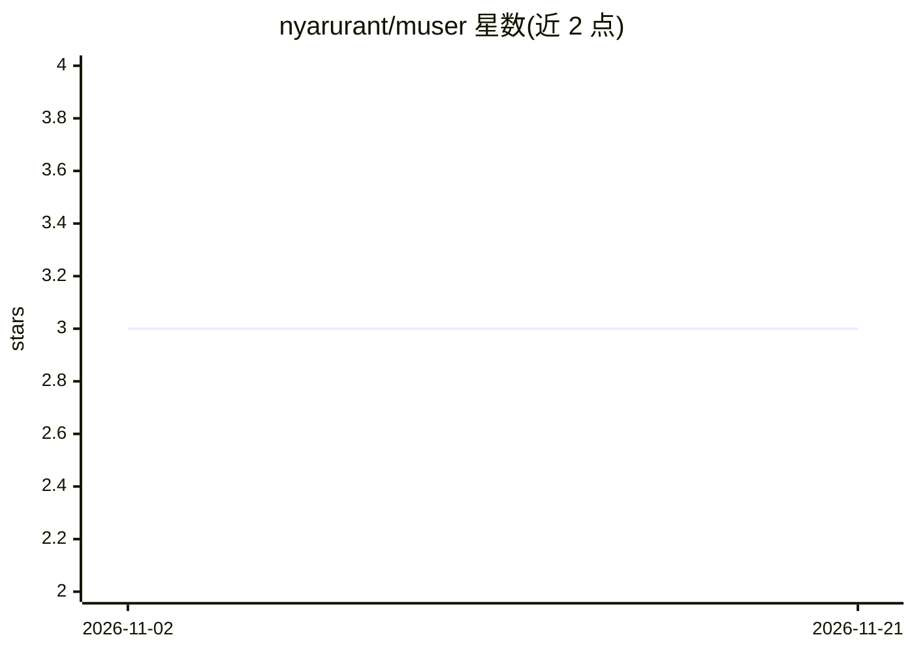

# nyarurant/muser

⭐ 3 · JavaScript · MIT · 推送 2026-11-08 · [GitHub](https://github.com/nyarurant/muser) · 个人维护

**Windows 终端 CLI：把本机注册为 Muse 设备进行协作编码**

非官方终端编码 agent，将本 PC 注册为 Muse（muse.ai）设备，使 Muse 在对话中读取/编辑本机文件并运行命令。界面风格参照 Claude Code / Codex CLI，提供交互 TUI 与 exec 一次性运行、JSON Lines 输出、状态文件供其他 agent 轮询、常驻服务器供 GUI/手机连接。依赖 Windows 10/11、Node.js 22+、Edge 登录窗口、ripgrep 与 muse.ai 账号；因使用 Muse 私有协议，对方变更可能导致失效。

## 筛选速览

| 维度 | 判定 | 备注 |
|---|---|---|
| AI 角色 | `ai-ecosystem` | LLM/agent 周边工具 |
| 许可风险 | `permissive` | MIT |
| 部署形态 | `library` | 以包/库形式分发 |
| 模型依赖 | — | README 未给出锁定关系 |
| 硬件要求 | — | 无带数字的原话,不猜 |
| 安装摩擦 | `low` | 无编译、无系统依赖或容器化 |
| 成熟度 | — | 结构信号不足 |

## 能力要点

- 注册本机为 Muse 设备，Muse 可读写文件与执行命令
- muser exec 支持 JSON 输出与状态文件，供 Codex/Claude Code 等 agent 轮询
- 内置 skills/muser-exec 技能，可安装到 Claude Code 与 Codex 技能目录
- 支持 Focus 完成度跟踪、常驻目标 /goal 与常驻服务器模式

## 适用场景

- 在终端里通过 muse.ai 账号对本机项目执行编码任务
- 把读代码量大的调研/审查任务交给 Muse 计划执行
- 让其他 coding agent 调用 muser exec 委托任务

## 场景标签

`编码 Agent` · 领域:编码与开发

## 证据(README 行号)

> L5: An **unofficial** terminal coding agent for Muse.
> L6: It registers this PC as a Muse "device", so Muse can read and edit files and run commands here while you work togeth
> L98: **For Claude Code and Codex:** the skill `skills/muser-exec` (in this repository and the npm package) teaches an ag

## 星数曲线

2026-11-02 3 → 2026-11-21 3（+0）

---
*卡片 v1 · prompt 1.4 · 生成 2026-11-21 · 置信度 high · 依据 README sha `e166e13cfc48` · [字段定义](../../DATASET.md)*
