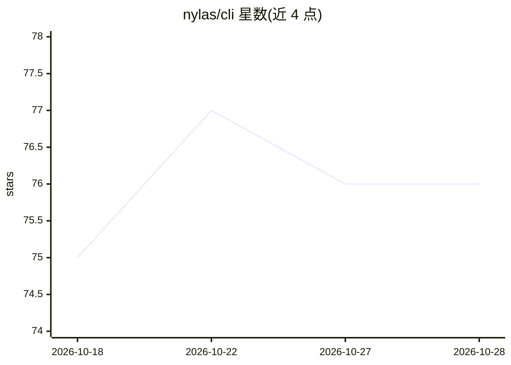

# nylas/cli

⭐ 76 · Go · MIT · 推送 2026-10-15 · [GitHub](https://github.com/nylas/cli) · [官网](https://cli.nylas.com/) · 组织维护

**Nylas 官方 CLI：终端统一管理邮件、日历、联系人**

Go 编写的统一命令行工具，通过 Nylas API 对接 Google、Microsoft 与 IMAP 邮箱，提供邮件读写/搜索/发送（含 GPG 签名加密）、日历事件与可用时间查询、联系人管理、Webhook 管理、离线时区工具及 OTP 提取。凭据存入系统 keyring，支持 CLI 与 TUI 两种界面。AI 部分：可启动 MCP 服务器让 AI 编码助手访问邮件/日历/联系人，并提供 nylas ai 对话命令与 AI 排程。安装途径含 Homebrew、go install、二进制发布与 Docker。

## 筛选速览

| 维度 | 判定 | 备注 |
|---|---|---|
| AI 角色 | `ai-enhanced` | 去掉 AI 部分产品仍成立 |
| 许可风险 | `permissive` | MIT |
| 部署形态 | `self-host` | docker 或自建部署 |
| 模型依赖 | — | README 未给出锁定关系 |
| 硬件要求 | — | 无带数字的原话,不猜 |
| 安装摩擦 | `low` | 无编译、无系统依赖或容器化 |
| 成熟度 | — | 结构信号不足 |

## 能力要点

- 邮件/日历/联系人/Webhook/时区的统一 CLI 与 TUI
- 内置 MCP 服务器，供 AI 编码助手访问邮件与日历
- 凭据存系统 keyring，支持 demo 模式免账号试用
- 支持 Homebrew/go install/二进制/Docker 四种分发方式

## 适用场景

- 在终端直接收发邮件、查日历与管理联系人
- 让 Claude Code/Cursor 等 AI 助手通过 MCP 操作我的邮箱
- 用一条命令配置 Nylas API 认证与邮箱连接

## 场景标签

 · 领域:通信API/开发者工具

## 证据(README 行号)

> L8: Email, calendar, and contacts from your terminal. One CLI for Google, Microsoft, and IMAP -- no SMTP config, no prov
> L136: ## AI & MCP Integration
> L142: nylas ai     # Chat with your data

## 星数曲线

2026-10-18 75 → 2026-10-28 76（+1）

---
*卡片 v1 · prompt 1.4 · 生成 2026-10-24 · 置信度 high · 依据 README sha `c0014498f9bd` · [字段定义](../../DATASET.md)*
