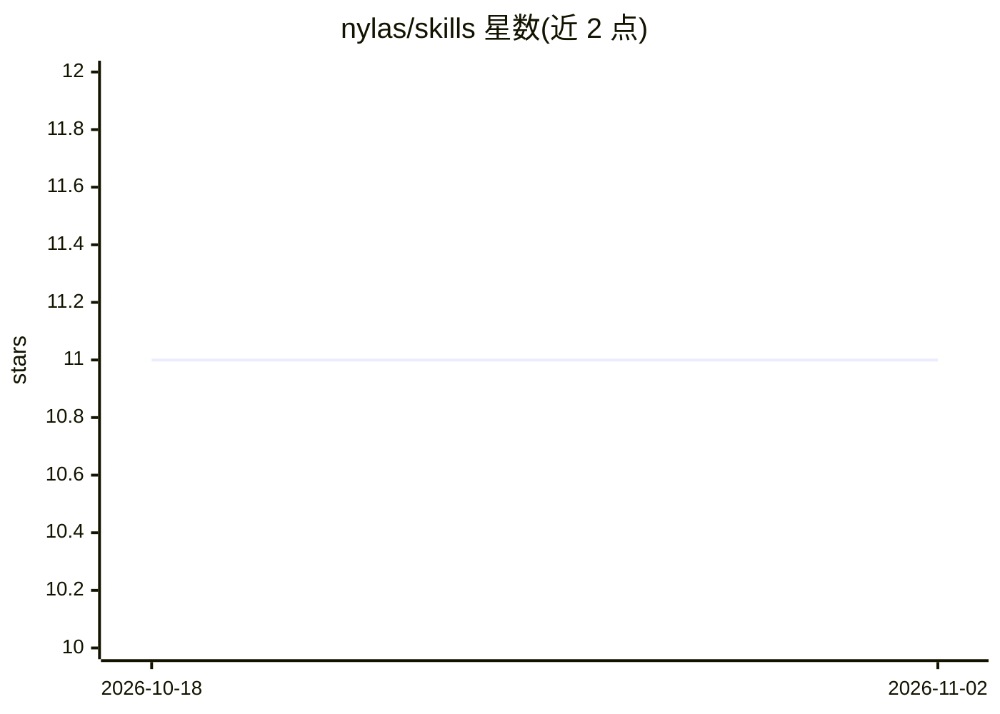

# nylas/skills

⭐ 11 · Shell · MIT · 推送 2026-10-05 · [GitHub](https://github.com/nylas/skills) · [官网](https://developer.nylas.com) · 组织维护

**面向 AI 编程 agent 的 Nylas 平台技能包：邮件/日历/联系人开发知识**

Nylas 官方维护的 Agent Skills 仓库，包含 3 个技能（nylas-api、nylas-cli、nylas-email-templates），以 SKILL.md 规则索引加编译参考的形式，向 Claude Code、Cursor、Codex CLI 等 40 余种 AI 编程 agent 提供使用 Nylas v3 API、CLI 与邮件模板的领域知识。内容覆盖邮件、日历、联系人、Agent Accounts、Webhooks、Scheduler、Notetaker 等平台能力。通过 npx skills add 命令或 Claude Code 插件市场安装，需配合 Nylas 平台账号与 API key 使用。

## 筛选速览

| 维度 | 判定 | 备注 |
|---|---|---|
| AI 角色 | `ai-knowledge` | 知识聚合/清单类 |
| 许可风险 | `permissive` | MIT |
| 部署形态 | `library` | 以包/库形式分发 |
| 模型依赖 | — | README 未给出锁定关系 |
| 硬件要求 | — | 无带数字的原话,不猜 |
| 安装摩擦 | `low` | 无编译、无系统依赖或容器化 |
| 成熟度 | — | 结构信号不足 |

## 能力要点

- 3 个技能：nylas-api、nylas-cli、nylas-email-templates
- 兼容 Claude Code、Cursor、Codex CLI 等 40+ AI 编程 agent
- Agent Accounts：为 AI agent 提供自有域名邮箱，可收发邮件与 RSVP
- SKILL.md 规则索引 + AGENTS.md 编译参考的技能结构

## 适用场景

- 让 AI 编程 agent 在写代码时正确调用 Nylas 邮件/日历/联系人 API
- 在终端中通过 agent 使用 Nylas CLI 管理邮件与日历
- 为 AI agent 配置独立邮箱身份处理收发信与多轮对话

## 场景标签

 · 领域:通信 API/开发者工具

## 证据(README 行号)

> L15: Agent Skills for building with the Nylas platform. Works with Claude Code, Cursor, Codex CLI, and 40+ other AI codi
> L19: ### nylas-api
> L90: skills/{skill-name}/

## 星数曲线

2026-10-18 11 → 2026-11-02 11（+0）

---
*卡片 v1 · prompt 1.4 · 生成 2026-11-01 · 置信度 high · 依据 README sha `9a61c704c112` · [字段定义](../../DATASET.md)*
