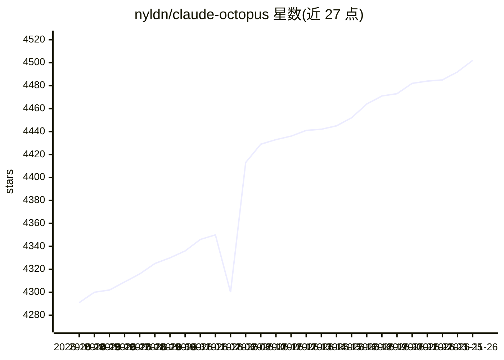

# nyldn/claude-octopus

⭐ 4,502 · Shell · MIT · 推送 2026-11-25 · [GitHub](https://github.com/nyldn/claude-octopus) · [官网](https://reddit.com/r/ClaudeOctopus/) · 个人维护

**给 Claude Code 用户的十二家模型多意见评审与共识门插件**

以 Claude Code 插件形式安装的多模型工作流集合：默认休眠，仅通过显式 /octo:* 命令激活；可在同一研究、设计或编码任务上调用多个外部模型，用 75% 共识门标记分歧。提供 31 个角色 persona、56 个斜杠命令、64 个技能模块，并集成 claude-mem 等 persistent memory 组件。零外部 provider 也可运行；支持 Codex、Cursor（MCP）、OpenCode 等宿主，Windows 需经 WSL 或 SSH。

## 筛选速览

| 维度 | 判定 | 备注 |
|---|---|---|
| AI 角色 | `ai-ecosystem` | LLM/agent 周边工具 |
| 许可风险 | `permissive` | MIT |
| 部署形态 | `desktop` | 安装包/桌面程序 |
| 模型依赖 | local-ok | 支持本地模型 |
| 硬件要求 | — | 无带数字的原话,不猜 |
| 安装摩擦 | `low` | 无编译、无系统依赖或容器化 |
| 成熟度 | — | 结构信号不足 |

## 能力要点

- 12 个外部 provider 集成与 75% 共识门标记模型分歧
- 31 personas / 56 命令 / 64 skills 的显式激活工作流
- Dark Factory 模式从规格自主运行 research→deliver 流水线
- 同一插件支持 Claude Code、Codex、Cursor(MCP)、OpenCode、Droid 宿主

## 适用场景

- 上线前让多个模型交叉评审代码找出分歧点
- 需要更严格的多模型审查流程替代单模型 review
- 跨会话保留研究决策与上下文的开发工作流

## 场景标签

`工作流自动化` `编码 Agent` · 领域:效率与自动化

## 证据(README 行号)

> L3: Every AI model has blind spots. Claude Octopus supports twelve external provider integrations — Codex, Antigravity C
> L17: 🐙 **Research, build, review, and ship — with twelve external providers checking the host's work.** Claude-native ha
> L55: Code's native manual-invocation gate. Start it with `/octo:*`.

## 星数曲线

2026-10-24 4,291 → 2026-11-26 4,502（+211）

---
*卡片 v1 · prompt 1.4 · 生成 2026-11-26 · 置信度 high · 依据 README sha `c831df88f0b0` · [字段定义](../../DATASET.md)*
