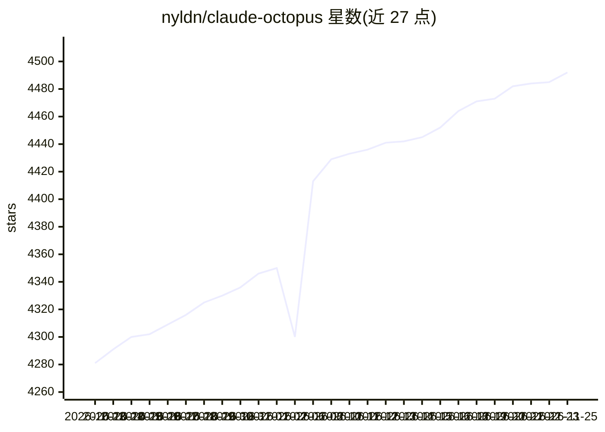

# nyldn/claude-octopus

⭐ 4,492 · Shell · MIT · 推送 2026-11-24 · [GitHub](https://github.com/nyldn/claude-octopus) · [官网](https://reddit.com/r/ClaudeOctopus/) · 个人维护

**Claude Code 多模型协同插件：多模型交叉审查任务**

一个 Claude Code 插件（也可装到 Codex CLI、Cursor MCP、OpenCode、Factory Droid 等宿主），在同一任务上调用多个 AI 模型并汇总体、对齐分歧，提供 75% 共识门槛在交付前标记不一致。内置 31 个角色化 agent、56 个斜杠命令、64 个技能模块，默认休眠、需 /octo:* 显式调用；支持 12 个外部模型服务接入与跨会话记忆集成。要求 Claude Code v2.1.14+，MIT 许可，支持 Linux/macOS，Windows 需 WSL 或 SSH。

## 筛选速览

| 维度 | 判定 | 备注 |
|---|---|---|
| AI 角色 | `ai-ecosystem` | LLM/agent 周边工具 |
| 许可风险 | `permissive` | MIT |
| 部署形态 | `desktop` | 安装包/桌面程序 |
| 模型依赖 | local-ok | 支持本地模型 |
| 硬件要求 | — | 无带数字的原话,不猜 |
| 安装摩擦 | `low` | 无编译、无系统依赖或容器化 |
| 成熟度 | — | 结构信号不足 |

## 能力要点

- 12 个外部模型服务集成 + 内置 Claude 宿主，零外部依赖即可起步
- 75% 共识门槛在交付前标记模型间分歧
- 31 个角色 agent、56 个命令、64 个技能，默认休眠、显式调用
- 支持 claude-mem/agentmemory/deja-vu 跨会话记忆与 Dark Factory 全流程自动化模式

## 适用场景

- 提交代码前用多模型交叉审查设计或实现
- 让多个模型对同一研究任务给出意见并对比分歧
- 在 Claude Code/Codex/Cursor 中统一接入多个模型服务工作流

## 场景标签

`代码审查` · 领域:编码与开发

## 证据(README 行号)

> L3: Every AI model has blind spots. Claude Octopus supports twelve external provider integrations — Codex, Antigravity C
> L17: 🐙 **Research, build, review, and ship — with twelve external providers checking the host's work.** Claude-native ha
> L25: 🐙 **31 specialized personas** (role-specific AI agents like security-auditor, backend-architect), **56 commands** (

## 星数曲线

2026-10-23 4,281 → 2026-11-25 4,492（+211）

---
*卡片 v1 · prompt 1.4 · 生成 2026-11-24 · 置信度 high · 依据 README sha `8cd48a297675` · [字段定义](../../DATASET.md)*
