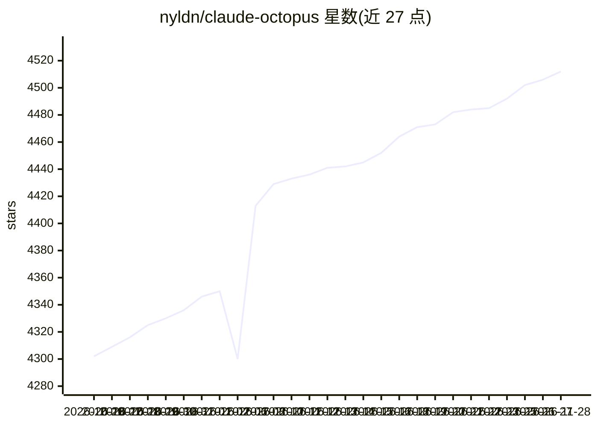

# nyldn/claude-octopus

⭐ 4,512 · Shell · MIT · 推送 2026-11-27 · [GitHub](https://github.com/nyldn/claude-octopus) · [官网](https://reddit.com/r/ClaudeOctopus/) · 个人维护

**给 Claude Code 用户的插件：多模型交叉审查并标出分歧**

作为 Claude Code 插件（也支持 Codex CLI、Cursor IDE、OpenCode、Factory Droid 等 host 安装）运行的多模型工作流系统：调用最多 12 个外部 provider 与内置 Claude Code host，对同一研究/设计/编码任务给出多模型意见，通过 75% 共识门槛标记分歧。提供 31 个角色 persona、56 个斜杠命令、64 个技能模块；默认休眠，需显式 `/octo:*` 触发。零外部 provider 即可起步。支持 Linux/macOS，Windows 需 WSL 或 SSH。

## 筛选速览

| 维度 | 判定 | 备注 |
|---|---|---|
| AI 角色 | `ai-ecosystem` | LLM/agent 周边工具 |
| 许可风险 | `permissive` | MIT |
| 部署形态 | `desktop` | 安装包/桌面程序 |
| 模型依赖 | local-ok | 支持本地模型 |
| 硬件要求 | — | 无带数字的原话,不猜 |
| 安装摩擦 | `low` | 无编译、无系统依赖或容器化 |
| 成熟度 | — | 结构信号不足 |

## 能力要点

- 接入 12 个外部 provider（Codex、Copilot、Ollama、OpenRouter、Qwen、Kimi Code 等），零 provider 可起步
- 75% 共识门槛在交付前标记多模型分歧
- 31 个 persona、56 个命令、64 个技能；Dark Factory 模式按 spec 自主运行完整流程
- 默认休眠、显式 `/octo:*` 触发；集成 claude-mem 等实现跨会话记忆

## 适用场景

- 代码交付前让多个模型交叉审查并发现分歧
- 安全审查时获取多模型对抗性评审意见
- 按 Discover→Define→Develop→Deliver 流程跑结构化开发工作流
- 在已有订阅基础上免费扩充多模型工作流（含本地 Ollama）

## 场景标签

`编码 Agent` `代码审查` · 领域:编码与开发

## 证据(README 行号)

> L3: Every AI model has blind spots. Claude Octopus supports twelve external provider integrations — Codex, Antigravity C
> L5: **Claude-native first, Octopus for escalation.** Use Claude-native `/init`, `/review`, and `/security-review` when C
> L17: 🐙 **Research, build, review, and ship — with twelve external providers checking the host's work.** Claude-native ha

## 星数曲线

2026-10-26 4,302 → 2026-11-28 4,512（+210）

---
*卡片 v1 · prompt 1.4 · 生成 2026-11-28 · 置信度 high · 依据 README sha `728a0d785c3d` · [字段定义](../../DATASET.md)*
