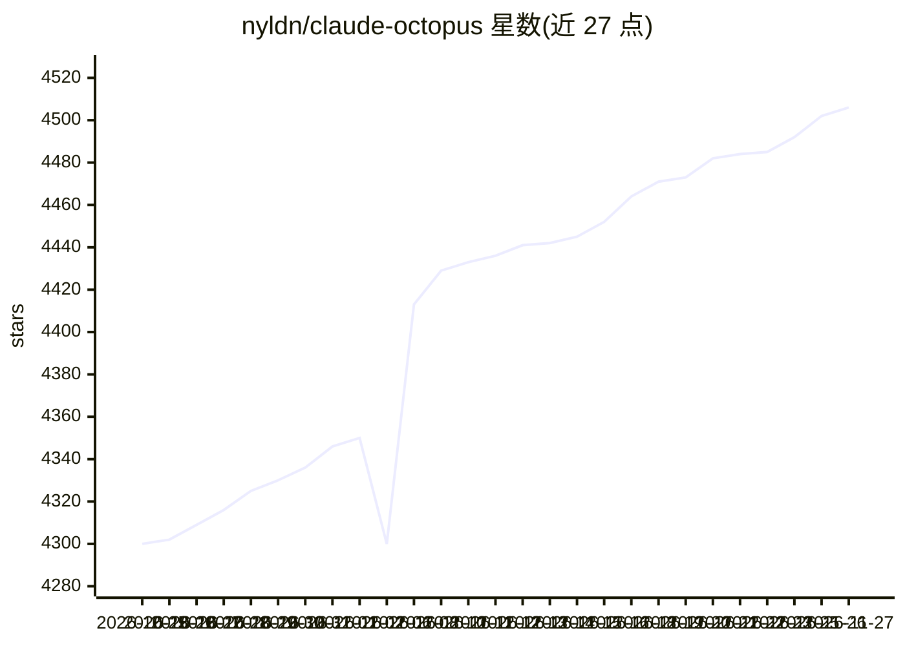

# nyldn/claude-octopus

⭐ 4,506 · Shell · MIT · 推送 2026-11-26 · [GitHub](https://github.com/nyldn/claude-octopus) · [官网](https://reddit.com/r/ClaudeOctopus/) · 个人维护

**面向 AI 编程工具的多模型共识审查插件：多模型比对后再交付**

一个以 Claude Code 为主宿、可安装到 Codex/Cursor/OpenCode/Factory Droid 的插件/MCP 服务器，支持十二个外部 provider 集成（Codex、Copilot、Qwen、Ollama、OpenRouter、Grok、Kimi Code 等），在用户显式运行 /octo:* 命令时让多个模型对同一研究/设计/编码任务给出意见，通过 75% 共识门标记分歧；内置 31 个角色 persona、56 个命令、64 个技能，支持跨会话记忆与 Dark Factory 规格驱动的自主流水线。默认休眠，不接管普通提示；要求 Claude Code v2.1.14+，Windows 需经 WSL 或 SSH 运行，不支持 Git Bash/MSYS2/Cygwin。

## 筛选速览

| 维度 | 判定 | 备注 |
|---|---|---|
| AI 角色 | `ai-ecosystem` | LLM/agent 周边工具 |
| 许可风险 | `permissive` | MIT |
| 部署形态 | `desktop` | 安装包/桌面程序 |
| 模型依赖 | local-ok | 支持本地模型 |
| 硬件要求 | — | 无带数字的原话,不猜 |
| 安装摩擦 | `low` | 无编译、无系统依赖或容器化 |
| 成熟度 | — | 结构信号不足 |

## 能力要点

- 支持 12 个外部 provider 集成，与内置 Claude Code 主宿并存
- 75% 共识门在交付前标记多模型分歧
- 31 persona / 56 命令 / 64 技能，默认休眠、显式 /octo:* 激活
- 同时支持 Claude Code、Codex 插件、Cursor MCP、OpenCode、Factory Droid 五种安装路径

## 适用场景

- 发布代码前让多个模型交叉审查同一任务并暴露分歧
- 为架构、调试、TDD 等任务选择对应的多模型工作流
- 已有 Claude Code 订阅时零外部 provider 起步，逐步接入其他模型

## 场景标签

`编码 Agent` `代码审查` · 领域:编码与开发

## 证据(README 行号)

> L3: Every AI model has blind spots. Claude Octopus supports twelve external provider integrations — Codex, Antigravity C
> L5: **Claude-native first, Octopus for escalation.** Use Claude-native `/init`, `/review`, and `/security-review` when C

## 星数曲线

2026-10-25 4,300 → 2026-11-27 4,506（+206）

---
*卡片 v1 · prompt 1.4 · 生成 2026-11-27 · 置信度 high · 依据 README sha `0ea252bafed3` · [字段定义](../../DATASET.md)*
