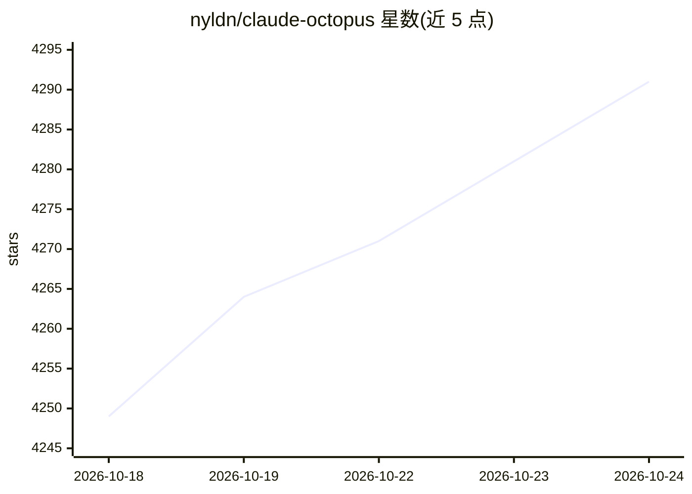

# nyldn/claude-octopus

⭐ 4,291 · Shell · MIT · 推送 2026-10-23 · [GitHub](https://github.com/nyldn/claude-octopus) · [官网](https://reddit.com/r/ClaudeOctopus/) · 个人维护

**Claude Code 多模型协作插件：多 AI 交叉审查并标记分歧**

以 Claude Code 为宿主的多 LLM 编排插件：同一研究、设计或编码任务可接入 Codex、Copilot、Qwen、Ollama、OpenRouter 等 12 个外部提供方，通过 75% 共识门禁在交付前标记模型间分歧。提供 31 个专业角色、54 个命令、63 个技能，含 /octo:council 多模型审议、Dark Factory 自主流水线与跨会话持久记忆集成。默认休眠，仅 /octo:* 显式激活；需 Claude Code v2.1.14+，Linux/macOS 原生运行，Windows 需经 WSL。

## 筛选速览

| 维度 | 判定 | 备注 |
|---|---|---|
| AI 角色 | `ai-ecosystem` | LLM/agent 周边工具 |
| 许可风险 | `permissive` | MIT |
| 部署形态 | `desktop` | 安装包/桌面程序 |
| 模型依赖 | local-ok | 支持本地模型 |
| 硬件要求 | — | 无带数字的原话,不猜 |
| 安装摩擦 | `low` | 无编译、无系统依赖或容器化 |
| 成熟度 | — | 结构信号不足 |

## 能力要点

- 12 个外部提供方集成加内置 Claude 宿主，75% 共识门禁
- /octo:council 3/5/7 角色跨模型审议，含对抗与红队风格
- 31 个角色、54 个命令、63 个技能，显式工作流触发
- 默认休眠、零外部提供方即可启动，claude-mem 等持久记忆集成

## 适用场景

- 重要设计或架构决策前获取多个模型的独立意见
- 对代码或研究结论做对抗性审查，捕获模型间分歧
- 在 Claude Code 内按需升级到多 LLM 审议工作流

## 场景标签

`代码审查` `多智能体` · 领域:Agent 开发

## 证据(README 行号)

> L3: Every AI model has blind spots. Claude Octopus supports twelve external provider integrations — Codex, Antigravity C
> L17: 🐙 **Research, build, review, and ship — with twelve external providers checking the host's work.** Claude-native ha
> L141: ```bash

## 星数曲线



2026-10-18 4,249 → 2026-10-24 4,291（+42）


---
*卡片 v1 · prompt 1.4 · 生成 2026-10-20 · 置信度 high · 依据 README sha `c7f88954a533` · [字段定义](../../DATASET.md)*
