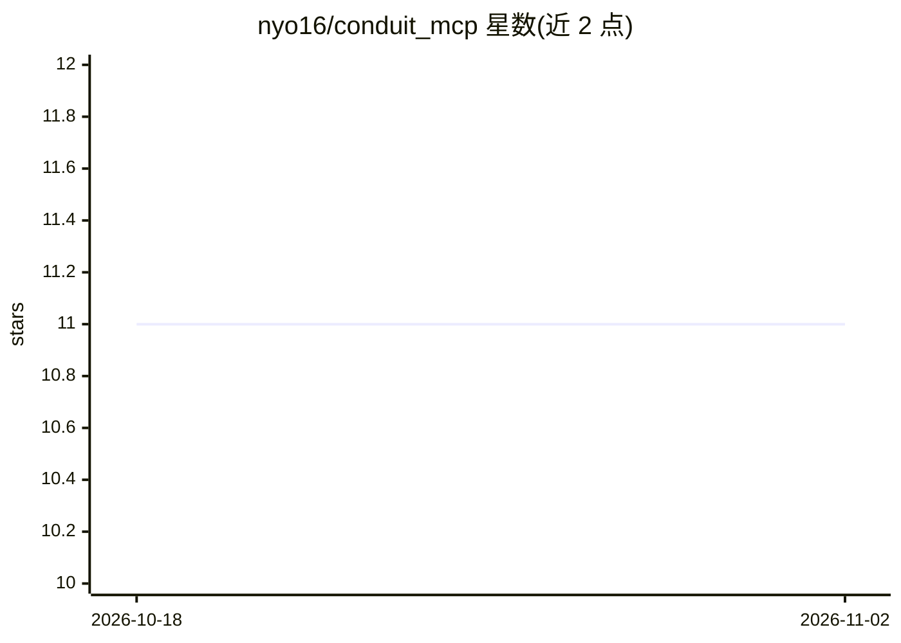

# nyo16/conduit_mcp

⭐ 11 · Elixir · Apache-2.0 · 推送 2026-10-18 · [GitHub](https://github.com/nyo16/conduit_mcp) · 个人维护

**Elixir 的 MCP 协议实现：构建向 LLM 应用暴露工具/资源/提示的服务端**

Model Context Protocol 的 Elixir 实现，同一服务端同时支持现代 2026-07-28 与旧版 2025-11-25 / 2025-06-18 协议时代，按请求选择。提供三种服务端构建方式（DSL 宏、原生回调、组件模块）、内置支持 stdio 与 Streamable HTTP 的监督式客户端、Bearer/API key/OAuth 2.1 认证、限流、可插拔会话存储（ETS/Redis/PostgreSQL/Mnesia）与 Phoenix 路由集成。通过 Hex 以依赖方式安装，需 Elixir ~> 1.18；库为 pre-1.0，部分模块（Tasks 扩展、Gemini 适配器等）标记为实验性。

## 筛选速览

| 维度 | 判定 | 备注 |
|---|---|---|
| AI 角色 | `ai-ecosystem` | LLM/agent 周边工具 |
| 许可风险 | `permissive` | Apache-2.0 |
| 部署形态 | `None` |  |
| 模型依赖 | — | README 未给出锁定关系 |
| 硬件要求 | — | 无带数字的原话,不猜 |
| 安装摩擦 | `low` | 无编译、无系统依赖或容器化 |
| 成熟度 | `idea` | |

## 能力要点

- 同一服务端支持双协议时代（2026-07-28 与 2025-11-25/2025-06-18）
- 三种服务端定义模式：DSL 宏、原生回调、Endpoint+组件
- 内置 MCP 客户端：多服务 hub、策略钩子、LLM 提供商适配器、OAuth 2.1
- 认证、限流、可插拔会话存储（ETS/Redis/PostgreSQL/Mnesia）与 Prometheus 指标

## 适用场景

- 用 Elixir 构建供 Claude Desktop、VS Code、Cursor 调用的 MCP 工具服务
- 在 Elixir 应用中作为客户端连接并管理多个 MCP 服务端
- 为现有 Phoenix 应用添加带认证与限流的 MCP 端点

## 场景标签

 · 领域:LLM 基础设施/MCP 协议

## 证据(README 行号)

> L5: An Elixir implementation of the Model Context Protocol (MCP) specification, serving both protocol eras from one serv
> L16: - **MCP Client** — Supervised client for stdio and Streamable HTTP servers in both eras, with a multi-server hub, p

## 星数曲线

2026-10-18 11 → 2026-11-02 11（+0）

---
*卡片 v1 · prompt 1.4 · 生成 2026-11-01 · 置信度 high · 依据 README sha `83a3c428ea3f` · [字段定义](../../DATASET.md)*
