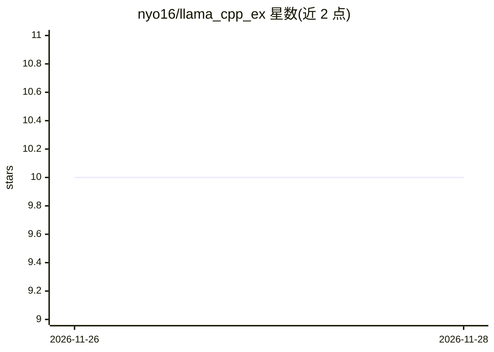

# nyo16/llama_cpp_ex

⭐ 10 · Elixir · Apache-2.0 · 推送 2026-11-26 · [GitHub](https://github.com/nyo16/llama_cpp_ex) · 个人维护

**给 Elixir 开发者本地运行 LLM 的 llama.cpp 绑定库**

面向 Elixir/Erlang 开发者的 llama.cpp NIF 绑定：通过 C++ NIF 直接加载运行 GGUF 模型，支持 Metal/CUDA/Vulkan/CPU 后端。提供流式生成、Jinja 聊天模板、OpenAI 形状的工具调用、GBNF 语法约束与 JSON Schema 结构化输出、嵌入生成、连续批处理服务器与多模型驻留管理。预编译 NIF 覆盖 Apple Silicon 与 x86_64 Linux；Vulkan、Windows 等场景需源码编译（C++17 编译器、CMake 3.14+、Git），由 fine 与 elixir_make 管理构建与资源。

## 筛选速览

| 维度 | 判定 | 备注 |
|---|---|---|
| AI 角色 | `ai-ecosystem` | LLM/agent 周边工具 |
| 许可风险 | `permissive` | Apache-2.0 |
| 部署形态 | `library` | 以包/库形式分发 |
| 模型依赖 | local-ok | 支持本地模型 |
| 硬件要求 | `cpu-ok` | |
| 安装摩擦 | `high` | 编译与系统依赖俱全 |
| 成熟度 | — | 结构信号不足 |

## 能力要点

- 从 Elixir 直接加载运行 GGUF 模型，支持 Metal/CUDA/Vulkan/CPU 加速
- 流式生成、Jinja 聊天模板、OpenAI 形状工具调用
- JSON Schema 自动转 GBNF 的结构化输出与 L2 归一化嵌入生成
- 连续批处理与按 GPU 显存预算的多模型管理器、请求取消与遥测集成

## 适用场景

- 在 Elixir/Phoenix 应用内嵌运行本地 LLM 推理
- 从 HuggingFace Hub 搜索下载 GGUF 模型并生成嵌入向量
- 需要语法约束或结构化 JSON 输出的本地推理服务
- 多模型常驻、按 id 路由请求的并发推理场景

## 场景标签

`推理引擎` · 领域:训练与推理

## 证据(README 行号)

> L6: Elixir bindings for llama.cpp — run LLMs locally with Metal, CUDA, Vulkan, or CPU acceleration.
> L8: Built with C++ NIFs using fine for ergonomic resource management and elixir_make for the build system.
> L26: - Continuous batching server for concurrent inference

## 星数曲线

2026-11-26 10 → 2026-11-28 10（+0）

---
*卡片 v1 · prompt 1.4 · 生成 2026-11-26 · 置信度 mid · 依据 README sha `179a517eacbd` · [字段定义](../../DATASET.md)*
