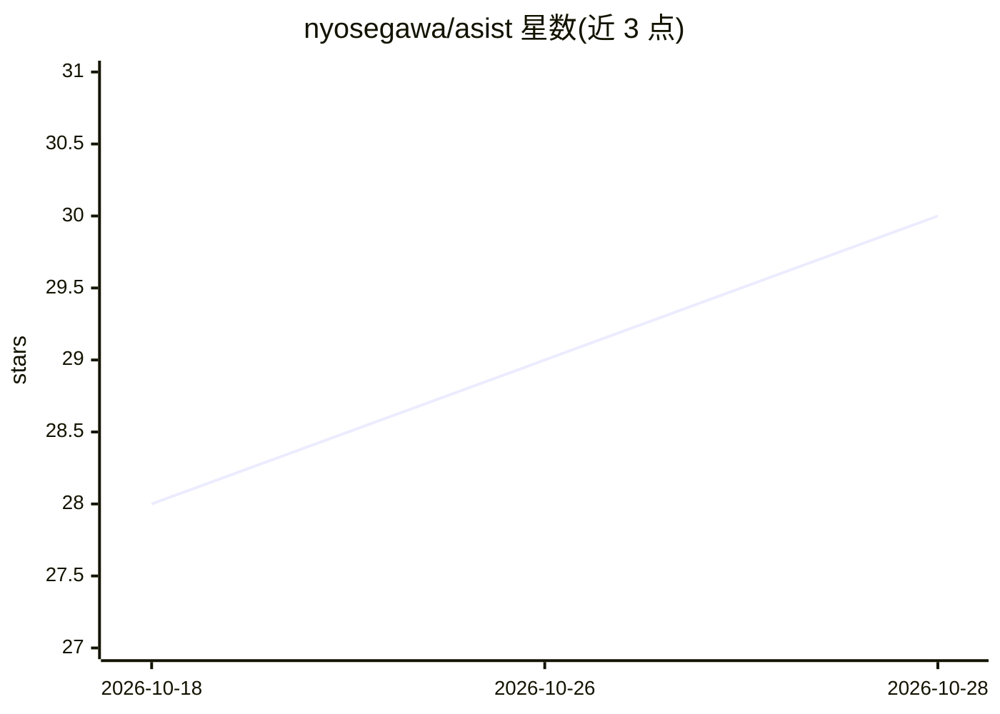

# nyosegawa/asist

⭐ 30 · TypeScript · MIT · 推送 2026-10-26 · [GitHub](https://github.com/nyosegawa/asist) · [官网](https://asist-agent.com) · 个人维护 · 中文 README

**Mac/Windows 实时语音助手：对话、日程邮件卡片与代理任务**

面向 Mac 与 Windows 用户的桌面实时语音助手：语音对话、语音回答，将天气、日程、邮件草稿、汇率等信息以卡片形式展示在对话旁；长耗时任务（研究、文件编辑）经用户批准后交给本机的 codex 或 claude CLI 代理执行。对话模型可从 Anthropic、OpenAI、Google、Cerebras 中选择，语音、记忆与笔记数据保存在本机。日历功能需 Google 账号，代理任务需安装 codex 或 claude CLI。

## 筛选速览

| 维度 | 判定 | 备注 |
|---|---|---|
| AI 角色 | `ai-native` | 本体是模型或模型工具 |
| 许可风险 | `permissive` | MIT |
| 部署形态 | `desktop` | 安装包/桌面程序 |
| 模型依赖 | — | README 未给出锁定关系 |
| 硬件要求 | — | 无带数字的原话,不猜 |
| 安装摩擦 | `low` | 无编译、无系统依赖或容器化 |
| 成熟度 | — | 结构信号不足 |

## 能力要点

- 语音对话与卡片式展示（天气/日程/邮件/汇率等）
- 长任务经批准后交给本机 codex 或 claude CLI 代理
- 对话模型可选 Anthropic/OpenAI/Google/Cerebras
- 本地保存记忆、笔记与对话历史，支持 11 种语言

## 适用场景

- 用语音询问日程、邮件和天气并得到口播与卡片回答
- 把研究和文件编辑等耗时工作交给代理执行并跟踪进度
- 日常对话自动整理进记忆并生成日记

## 场景标签

`语音 Agent` `AI 助手` · 领域:对话与助手

## 证据(README 行号)

> L18: ASIST is an assistant you talk to, and it answers in its own voice. Weather, events and mail appear as cards beside
> L35: - **Hand tedious work to an agent.** Research and file edits go to the codex or claude CLI, and you can watch the p
> L41: You need an Apple Silicon Mac with macOS 14 or later, or an x64 PC with Windows 11, and an API key for a conversati

## 星数曲线

2026-10-18 28 → 2026-10-28 30（+2）

---
*卡片 v1 · prompt 1.4 · 生成 2026-10-26 · 置信度 mid · 依据 README sha `fd7cf729cc8e` · [字段定义](../../DATASET.md)*
