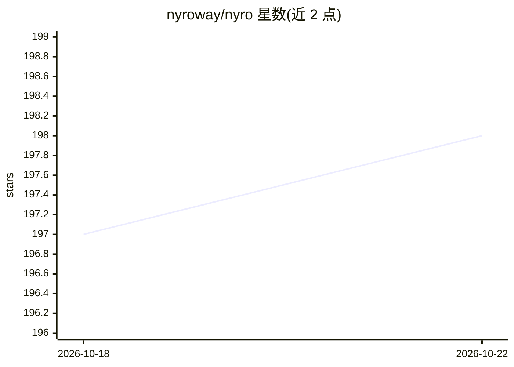

# nyroway/nyro

⭐ 198 · Rust · Apache-2.0 · 推送 2026-10-16 · [GitHub](https://github.com/nyroway/nyro) · 组织维护 · 中文 README

**本地 AI 网关：让 Claude Code 等工具接入任意模型提供商**

Nyro 是运行在本地的 AI 网关，位于 AI 编程工具与模型提供商之间，实时转换 OpenAI/Anthropic/Gemini 三种协议，使 Claude Code、Codex CLI、Gemini CLI、OpenCode 及各 SDK 客户端不改代码即可路由到任意后端模型。提供路由（虚拟模型、加权负载均衡、故障转移）、精确与语义缓存、按 key 配额的默认拒绝鉴权、请求日志与用量图表。以桌面应用（macOS/Windows/Linux）与无头服务器二进制分发，支持 Docker、SQLite/PostgreSQL/MySQL 存储及多副本共享数据库部署，另有实验性 Rust 数据平面。

## 筛选速览

| 维度 | 判定 | 备注 |
|---|---|---|
| AI 角色 | `ai-ecosystem` | LLM/agent 周边工具 |
| 许可风险 | `permissive` | Apache-2.0 |
| 部署形态 | `desktop` | 安装包/桌面程序 |
| 模型依赖 | locked-api |  |
| 硬件要求 | — | 无带数字的原话,不猜 |
| 安装摩擦 | `low` | 无编译、无系统依赖或容器化 |
| 成熟度 | — | 结构信号不足 |

## 能力要点

- OpenAI/Anthropic/Gemini 协议实时互转，含流式与跨协议工具调用归一化
- 虚拟模型路由：加权负载均衡、优先级故障转移、健康感知恢复
- 精确缓存与基于 embedding 的语义缓存，支持流式回放
- 检测已安装的 AI 工具并一键写入正确配置

## 适用场景

- 让 Claude Code 用非 Anthropic 的模型，多个工具共用同一后端
- 在 UI 中切换模型提供商而不改动工具配置
- 团队自托管统一网关，按 key 管控配额与路由权限

## 场景标签

`模型网关` · 领域:Agent 开发

## 证据(README 行号)

> L12: Nyro is a local AI gateway that sits between your AI tools and model providers. It translates protocol formats on t
> L3:  Run your AI coding tools on any model, from any provider.

## 星数曲线

2026-10-18 197 → 2026-10-22 198（+1）

---
*卡片 v1 · prompt 1.4 · 生成 2026-10-22 · 置信度 high · 依据 README sha `39f86ba2fe51` · [字段定义](../../DATASET.md)*
