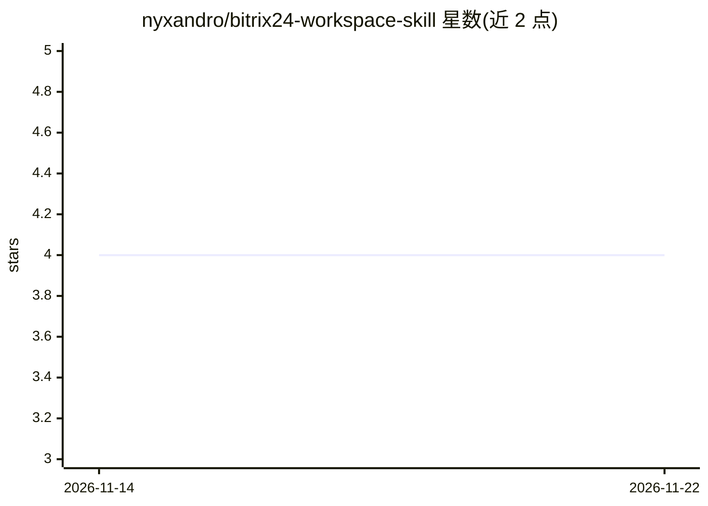

# nyxandro/bitrix24-workspace-skill

⭐ 4 · JavaScript · MIT · 推送 2026-11-13 · [GitHub](https://github.com/nyxandro/bitrix24-workspace-skill) · 个人维护

**让 AI 代理只读访问 Bitrix24 工作区的技能**

面向 Claude Code、Codex、OpenCode、Cursor 等 Agent Skills 兼容代理的 Bitrix24 工作区技能：通过入站 webhook 调用 REST API，以只读方式读取聊天、任务、项目、磁盘文件、邮件、日历、会议记录、信息流与知识库。写操作在程序层面被白名单禁止（仅收录读取方法）；输出为固定字段的 JSON，长文本截断，限速每秒两次请求，并对类似密钥的值做遮蔽处理。需 Node.js 20.19+，全部代码为单文件，无 npm 依赖。

## 筛选速览

| 维度 | 判定 | 备注 |
|---|---|---|
| AI 角色 | `ai-ecosystem` | LLM/agent 周边工具 |
| 许可风险 | `permissive` | MIT |
| 部署形态 | `library` | 以包/库形式分发 |
| 模型依赖 | — | README 未给出锁定关系 |
| 硬件要求 | — | 无带数字的原话,不猜 |
| 安装摩擦 | `low` | 无编译、无系统依赖或容器化 |
| 成熟度 | — | 结构信号不足 |

## 能力要点

- 通过入站 webhook 只读访问 Bitrix24 聊天/任务/磁盘/邮件/日历/知识库
- 程序级方法白名单强制只读，未授权调用在发送前被拒绝
- 密钥与 webhook 地址不出现在输出中，敏感值替换为隐藏标记
- 支持 Claude Code 插件、npx skills、install.sh 与手动解压四种安装方式

## 适用场景

- 用自然语言向代理询问一周内项目相关的聊天与邮件
- 让代理查找磁盘上的文档并读出关键信息
- 查看日程与视频会议纪要中达成的约定与任务

## 场景标签

 · 领域:办公协作/AI 代理集成

## 证据(README 行号)

> L14: Скилл для Claude Code, Codex, OpenCode, Cursor и других агентов, которые понимают Agent Skills и
> L17: REST API Битрикс24, а не по памяти. Запускать CLI руками не нужно.
> L21: список разрешённых методов, и все они читающие.

## 星数曲线

2026-11-14 4 → 2026-11-22 4（+0）

---
*卡片 v1 · prompt 1.4 · 生成 2026-11-21 · 置信度 high · 依据 README sha `2538e1c950c8` · [字段定义](../../DATASET.md)*
