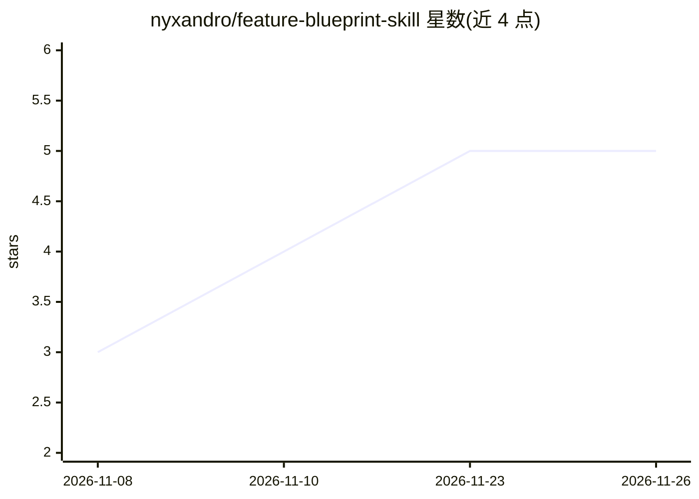

# nyxandro/feature-blueprint-skill

⭐ 5 · Python · MIT · 推送 2026-11-11 · [GitHub](https://github.com/nyxandro/feature-blueprint-skill) · 个人维护

**为 AI agent 写功能规格与实现计划的 Claude Code 技能**

以 Agent Skills 格式发布的规格先行技能：用户给出功能想法后，技能读取项目代码，检索官方文档、工程博客等外部实践，产出含 PRD 式产品部分、技术设计和带测试的分步计划的规格文档，保存到 docs/specs/，并将需要人工决策的事项以选项加推荐的方式汇总提问。另提供 review 模式审查已有计划或 PR。通过 Claude Code 插件市场或 npx skills 安装，兼容 Codex、OpenCode、Cursor 等读取 Agent Skills 的 agent。研究步骤依赖 web 搜索与子 agent 工具，缺失时仍可运行但会说明未核验项。

## 筛选速览

| 维度 | 判定 | 备注 |
|---|---|---|
| AI 角色 | `ai-ecosystem` | LLM/agent 周边工具 |
| 许可风险 | `permissive` | MIT |
| 部署形态 | `library` | 以包/库形式分发 |
| 模型依赖 | — | README 未给出锁定关系 |
| 硬件要求 | — | 无带数字的原话,不猜 |
| 安装摩擦 | `low` | 无编译、无系统依赖或容器化 |
| 成熟度 | — | 结构信号不足 |

## 能力要点

- 生成 PRD 式产品部分、技术设计与带测试的分步实现计划
- 检索官方文档、工程博客、postmortem 与流行仓库作为依据
- fresh-agent 审查机制复核草稿，review 模式可审查已有计划/PR
- 以 Agent Skills 格式兼容 Codex、OpenCode、Cursor 等 agent

## 适用场景

- 把功能想法转成 agent 可直接实施的规格文档
- 审查已有功能计划或 PR 中的漏洞
- 非写代码的产品负责人以自然语言做产品决策

## 场景标签

`代码审查` · 领域:编码与开发

## 证据(README 行号)

> L12: Feature Blueprint brings spec-driven development to Claude Code, Codex, OpenCode, Cursor and any
> L48: |Claude Code, as a plugin|`/plugin install feature-blueprint --marketplace nyxandro/skills`|

## 星数曲线

2026-11-08 3 → 2026-11-26 5（+2）

---
*卡片 v1 · prompt 1.4 · 生成 2026-11-21 · 置信度 high · 依据 README sha `3dbc2c8267a0` · [字段定义](../../DATASET.md)*
