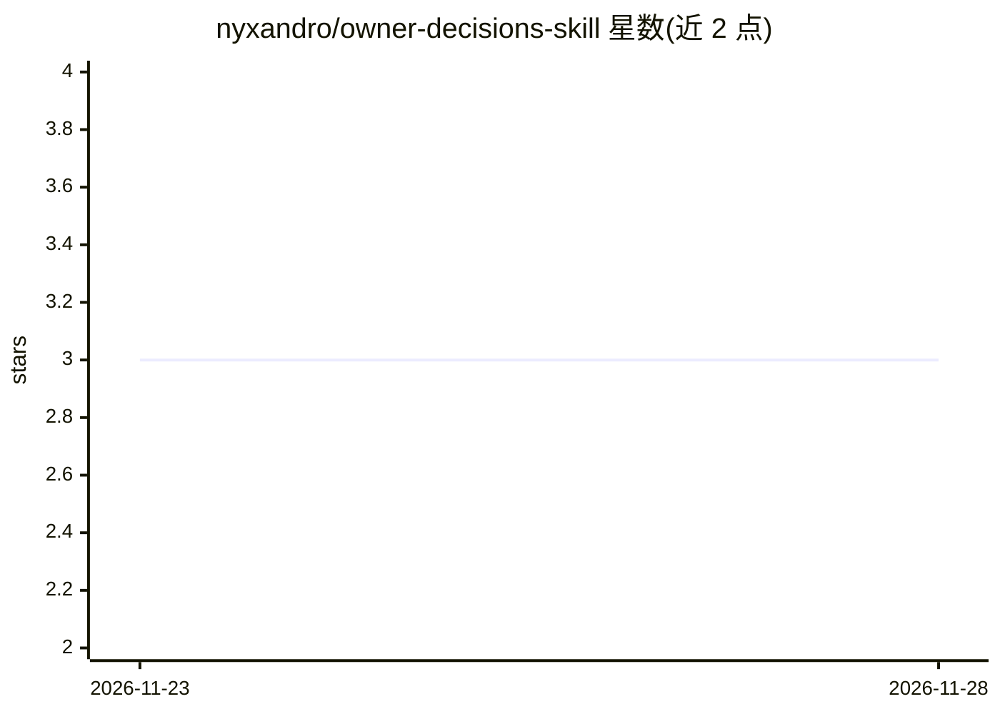

# nyxandro/owner-decisions-skill

⭐ 3 · Shell · MIT · 推送 2026-11-19 · [GitHub](https://github.com/nyxandro/owner-decisions-skill) · 个人维护 · 中文 README

**给 AI 编码代理记录个人决策日志的 Agent Skill，跨项目复用你的决定**

一个供 Claude Code、Codex、OpenCode、Cursor 等读取 Agent Skills 的代理使用的技能：在私有 markdown 文件库中保存用户在项目中的决策记录。代理在向用户提问前先检索该库，已决问题不再重复询问，仅追问新问题，并把回答写回库中；库通过私有 Git 仓库跨机器同步，无数据库、无向量检索。涉及花钱或不可逆操作的决策始终交还用户。通过插件市场、npx 或手动解包安装，脚本依赖 git 与 bash。

## 筛选速览

| 维度 | 判定 | 备注 |
|---|---|---|
| AI 角色 | `ai-ecosystem` | LLM/agent 周边工具 |
| 许可风险 | `permissive` | MIT |
| 部署形态 | `library` | 以包/库形式分发 |
| 模型依赖 | — | README 未给出锁定关系 |
| 硬件要求 | — | 无带数字的原话,不猜 |
| 安装摩擦 | `low` | 无编译、无系统依赖或容器化 |
| 成熟度 | — | 结构信号不足 |

## 能力要点

- 决策库为纯 markdown 文件（cases/topics/stops.md），可手工读取、编辑与回滚
- 已决问题不再询问，仅追问库未覆盖的新问题，且记录反转与停止项
- 支持私有 GitHub/GitLab/自建 git 仓库同步，公开仓库被拒绝
- 花钱类与不可逆类决策不代决，始终交由用户

## 适用场景

- 在多个由 AI 代理推进的项目间保持一致的决策方式
- 减少代理在每次会话中重复询问同类问题
- 为团队或个人沉淀可复查的技术决策记录

## 场景标签

`Agent 记忆` · 领域:Agent 开发

## 证据(README 行号)

> L12: Owner Decisions is a skill for Claude Code, Codex, OpenCode, Cursor and other agents that read
> L13: Agent Skills. It keeps a decision log of your own choices across all projects in a private base

## 星数曲线

2026-11-23 3 → 2026-11-28 3（+0）

---
*卡片 v1 · prompt 1.4 · 生成 2026-11-23 · 置信度 high · 依据 README sha `8de36d120406` · [字段定义](../../DATASET.md)*
