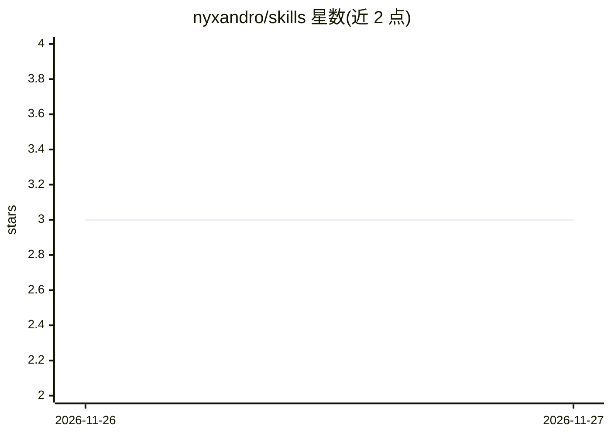

# nyxandro/skills

⭐ 3 · MIT · 推送 2026-11-13 · [GitHub](https://github.com/nyxandro/skills) · 个人维护 · 中文 README

**Claude Code 等 Agent 的技能目录市场，可一键安装插件**

一个 Claude Code 插件市场（marketplace）目录仓库：作者将自己的 agent skills 分别放在独立仓库中，每个技能有自己的版本、release 和 changelog，本仓库通过 marketplace.json 索引，供 Claude Code 从一处安装。技能分三类：规划与质量（feature 规格撰写、property-based 测试、第二意见、技能挑选）、项目运行（生产环境只读侦察、问题清单、会话交接、长期任务、决策库、资料收纳）、领域技能（Telegram 机器人、T-Invest 账户、Bitrix24 只读访问）。同样的技能可在 Codex、OpenCode、Cursor 等读取 Agent Skills 的 agent 中使用。

## 筛选速览

| 维度 | 判定 | 备注 |
|---|---|---|
| AI 角色 | `ai-knowledge` | 知识聚合/清单类 |
| 许可风险 | `permissive` | MIT |
| 部署形态 | `library` | 以包/库形式分发 |
| 模型依赖 | — | README 未给出锁定关系 |
| 硬件要求 | — | 无带数字的原话,不猜 |
| 安装摩擦 | `low` | 无编译、无系统依赖或容器化 |
| 成熟度 | — | 结构信号不足 |

## 能力要点

- 技能独立仓库维护版本与 changelog，本仓库仅作目录索引
- 支持 Claude Code 插件方式安装，Codex/OpenCode/Cursor 经 npx skills add 安装
- 每次 push 由 GitHub 跑 claude plugin validate --strict 校验目录
- 技能覆盖规划质量、项目运行与 Telegram/T-Invest/Bitrix24 领域

## 适用场景

- 为 Claude Code 项目安装 feature 规格与 property-based 测试技能
- 跨 Codex/Cursor 复用同一套 agent 技能
- 通过 prod-recon 技能对生产环境做只读检查

## 场景标签

`Agent 框架` · 领域:Agent 开发

## 证据(README 行号)

> L12: A Claude Code plugin marketplace with my agent skills. Each skill lives in its own repository, with
> L13: its own versions, releases and changelog. This repository only lists them, so Claude Code can
> L36: ## Skills

## 星数曲线

2026-11-26 3 → 2026-11-27 3（+0）

---
*卡片 v1 · prompt 1.4 · 生成 2026-11-26 · 置信度 high · 依据 README sha `eec6443c9d27` · [字段定义](../../DATASET.md)*
