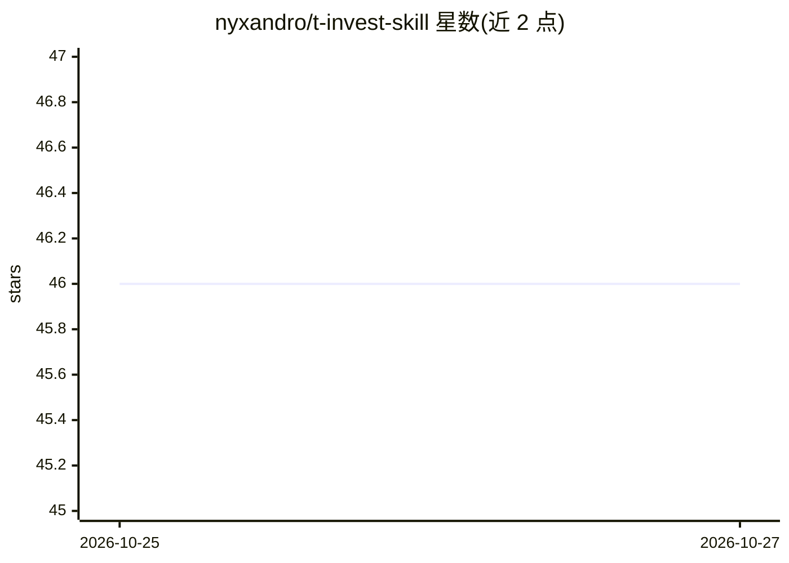

# nyxandro/t-invest-skill

⭐ 46 · TypeScript · MIT · 推送 2026-10-23 · [GitHub](https://github.com/nyxandro/t-invest-skill) · 个人维护

**让 AI 代理通过 T-Invest API 操作俄券商经纪账户的技能包与 CLI**

面向 Claude Code 等能读取 SKILL.md 并执行 shell 命令的 AI 代理的技能包：内嵌单文件 CLI，通过 T-Invest API 提供经纪账户的组合持仓、XIRR 收益率、市场行情、技术指标、筛选器与下单功能。设三档令牌模式（sandbox/readonly/full），真实交易需环境标志加逐笔 --confirm 确认，readonly 模式在代码层面禁止变更，含流动性守卫、幂等键与审计日志。声明不构成投资咨询，无法出金转账。安装支持插件市场、curl 一键脚本或手动解压。

## 筛选速览

| 维度 | 判定 | 备注 |
|---|---|---|
| AI 角色 | `ai-ecosystem` | LLM/agent 周边工具 |
| 许可风险 | `permissive` | MIT |
| 部署形态 | `None` |  |
| 模型依赖 | — | README 未给出锁定关系 |
| 硬件要求 | — | 无带数字的原话,不猜 |
| 安装摩擦 | `low` | 无编译、无系统依赖或容器化 |
| 成熟度 | — | 结构信号不足 |

## 能力要点

- 单文件 CLI，唯一外部依赖 Node.js ≥ 20，无需 npm 包
- 三档令牌模式 + 交易门控：full 模式需环境标志与逐笔确认
- YTM、久期、XIRR 由 CLI 自行计算，T-Invest API 不提供现成值
- 所有变更写入审计日志 trades.log

## 适用场景

- 用自然语言查询自己的投资组合持仓与真实收益率
- 让代理在沙盒账户中执行和测试交易策略
- 筛选债券与股票并查看分析师预测数据

## 场景标签

`金融量化` · 领域:学习与行业

## 证据(README 行号)

> L46: Нужно: **Node.js ≥ 20** (единственная внешняя зависимость — весь код вшит в один
> L16: реальным данным счёта, а не по памяти. Вручную запускать CLI не нужно.

## 星数曲线

2026-10-25 46 → 2026-10-27 46（+0）

---
*卡片 v1 · prompt 1.4 · 生成 2026-10-25 · 置信度 high · 依据 README sha `af7bcf175358` · [字段定义](../../DATASET.md)*
