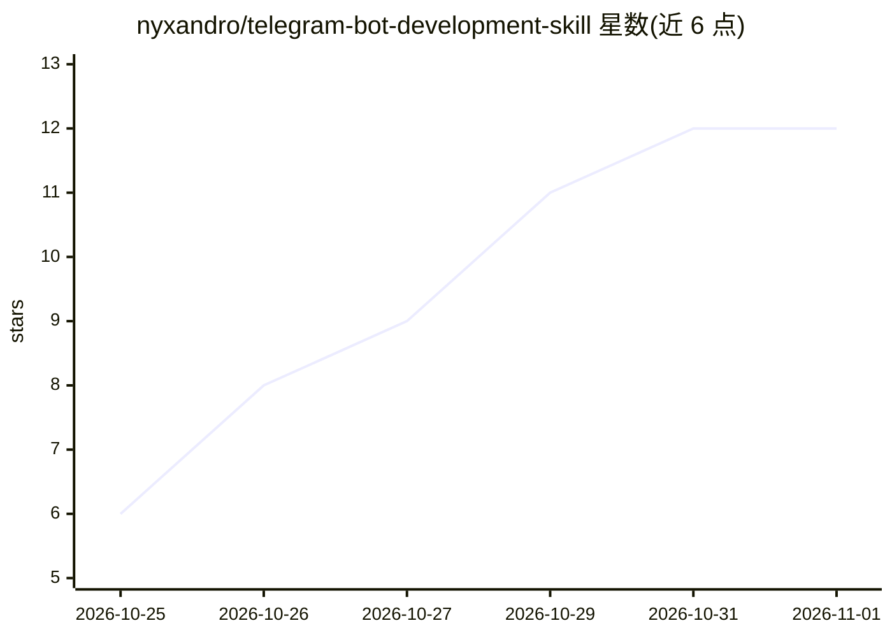

# nyxandro/telegram-bot-development-skill

⭐ 12 · Python · MIT · 推送 2026-10-23 · [GitHub](https://github.com/nyxandro/telegram-bot-development-skill) · 个人维护

**让 Claude Code/OpenCode 开发 Telegram bot 时核验实时文档的技能包**

面向 Claude Code 与 OpenCode 的 agent 技能：在编写、审查或推荐 Bot API 调用前，强制 agent 读取 Telegram 官方在线文档与项目已安装的库（grammY、aiogram、python-telegram-bot、Telegraf 等），避免凭记忆调用已废弃参数或过时的限制与费率。附带两个仅用标准库的 Python 3.8+ 脚本（拉取官方文档 Markdown、检查库对方法/类型/参数的支持），页面缓存 6 小时；含 11 份按需阅读的参考文档与发布前审查清单。无 Python 时退化为提供官方页面 URL。

## 筛选速览

| 维度 | 判定 | 备注 |
|---|---|---|
| AI 角色 | `ai-knowledge` | 知识聚合/清单类 |
| 许可风险 | `permissive` | MIT |
| 部署形态 | `None` |  |
| 模型依赖 | — | README 未给出锁定关系 |
| 硬件要求 | — | 无带数字的原话,不猜 |
| 安装摩擦 | `low` | 无编译、无系统依赖或容器化 |
| 成熟度 | — | 结构信号不足 |

## 能力要点

- 写作前强制核验实时 Bot API 文档与已安装库的支持情况
- tgdocs.py 读取官方文档 Markdown：版本、变更、方法/类型页、名称历史、开发者条款
- find_method_support.py 检查库是否支持方法/类型/METHOD.PARAMETER
- 11 份按需阅读的参考（更新、键盘、安全、限额、Stars 支付、Mini Apps、AI bots 等）

## 适用场景

- 让 Claude Code 或 OpenCode 帮我写不依赖过时记忆的 Telegram bot
- 审查现有 bot 代码中的 Bot API 调用是否已被新版替换
- 开发 Mini Apps 或 Stars 支付等新特性前核对官方文档与条款

## 场景标签

`代码审查` · 领域:编码与开发

## 证据(README 行号)

> L5: A Telegram bot development skill for Claude Code and OpenCode: build, review and debug Telegram
> L112:   SKILL.md                            the workflow: the live API and the installed library first

## 星数曲线

2026-10-25 6 → 2026-11-01 12（+6）

---
*卡片 v1 · prompt 1.4 · 生成 2026-11-01 · 置信度 high · 依据 README sha `7db49f759732` · [字段定义](../../DATASET.md)*
