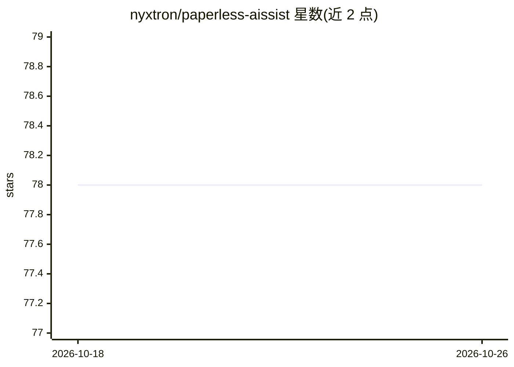

# nyxtron/paperless-aissist

⭐ 78 · Python · MIT · 推送 2026-10-06 · [GitHub](https://github.com/nyxtron/paperless-aissist) · [官网](https://nyxtron.github.io/paperless-aissist/) · 个人维护

**给 Paperless-ngx 用户的 LLM 文档处理 Web 应用**

围绕 Paperless-ngx 的 Docker 自托管 Web 应用：通过标签触发按步骤的 AI 管线，包括标题生成、 correspondent/文档类型/标签分类（带概率决策模式与人工复核标记）、自定义字段抽取、视觉 OCR、OCR 纠错与日期检测，另提供文档对话与搜索预览。文本与视觉模型分别配置，支持 Ollama 本地运行及 OpenAI、Grok、OpenRouter 云端。所有设置经 Web UI 存入 SQLite，无需环境变量；提供 Automation API 供 cron/Home Assistant 调用，模块化步骤标签可组合执行。

## 筛选速览

| 维度 | 判定 | 备注 |
|---|---|---|
| AI 角色 | `ai-native` | 本体是模型或模型工具 |
| 许可风险 | `permissive` | MIT |
| 部署形态 | `self-host` | docker 或自建部署 |
| 模型依赖 | local-ok | 支持本地模型 |
| 硬件要求 | — | 无带数字的原话,不猜 |
| 安装摩擦 | `low` | 无编译、无系统依赖或容器化 |
| 成熟度 | — | 结构信号不足 |

## 能力要点

- 标签驱动的模块化管线：ai-title/ai-ocr/ai-fields 等步骤标签可单独或组合触发
- 文本与视觉模型独立配置，元数据可跑本地 Ollama、OCR 用付费视觉模型
- 决策模式按概率选择 correspondent/文档类型，不确定则留空并标记复核
- Automation API（bearer token）供 cron、Home Assistant、脚本调用

## 适用场景

- 给已扫描的 Paperless 文档自动生成标题、分类与标签
- 用视觉模型重读扫描件做 OCR 与纠错
- 在网页里就单份文档提问与预览 AI 处理效果
- 配合 Home Assistant 自动处理新进文档

## 场景标签

`OCR` `文档解析` `文档问答` · 领域:知识与检索

## 证据(README 行号)

> L16: - **Title generation** — replaces scanned filenames with meaningful titles
> L18: - **Vision OCR** — uses vision models (Ollama, OpenAI, Grok, OpenRouter) to read documents directly from page image
> L21: - **Document chat** — ask questions about any document via the web UI

## 星数曲线

2026-10-18 78 → 2026-10-26 78（+0）

---
*卡片 v1 · prompt 1.4 · 生成 2026-10-24 · 置信度 high · 依据 README sha `423e81e4d61e` · [字段定义](../../DATASET.md)*
